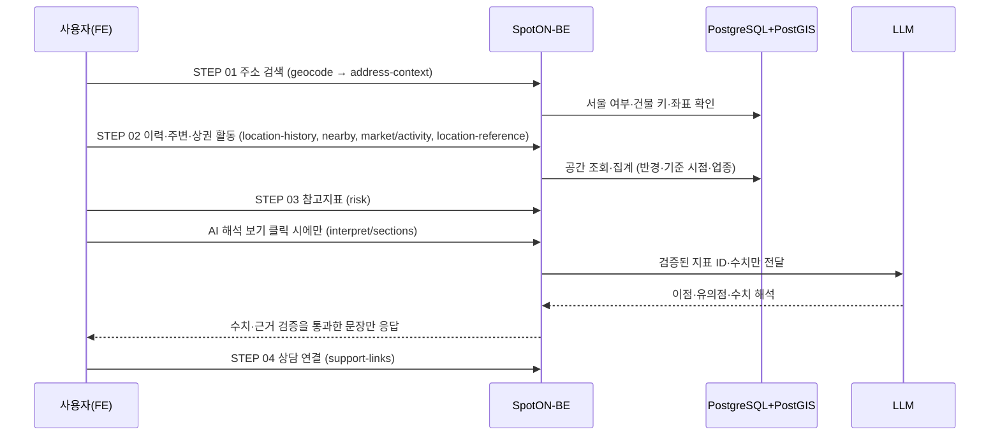
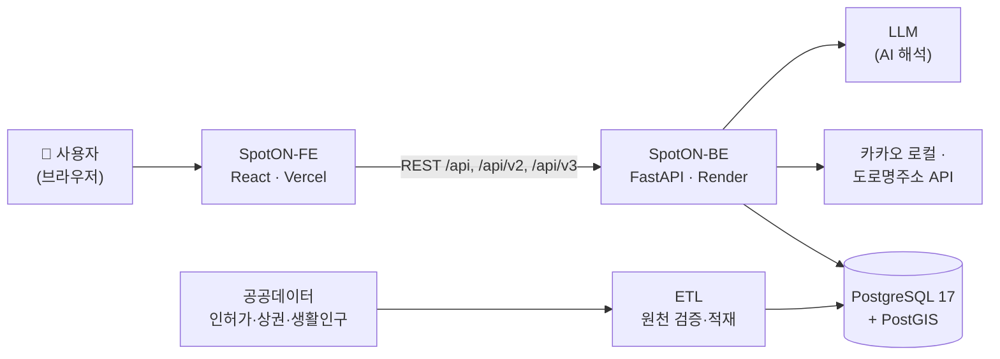

<div align="center">

# Spot:ON Backend

**Is your spot on? — 내 자리, 딱 맞는 자리일까요?**

서울 카페·음식점 예비창업자를 위한 **공공데이터 기반 창업 입지 진단 웹서비스**의 백엔드 API 서버<br>
인허가·상권·생활인구 공공데이터를 공간 조회하고, 출처·기준일과 함께 검증된 지표와 AI 해석을 제공해요.

[🌐 서비스 바로가기](https://spot-on-fe-two.vercel.app) · [📖 API 문서(Swagger)](https://spoton-be-free.onrender.com/docs) · [💻 프론트엔드 저장소](https://github.com/sigoreu-jabeujong/SpotON-FE) · [⚙️ 백엔드 저장소](https://github.com/sigoreu-jabeujong/SpotON-BE)


</div>

---

## 목차

1. [접속 주소](#1-접속-주소)
2. [프로젝트 소개](#2-프로젝트-소개)
3. [주요 기능](#3-주요-기능)
4. [작동 방법](#4-작동-방법)
5. [실행 파일 · URL](#5-실행-파일--url)
6. [실행 방법](#6-실행-방법)
7. [시스템 구성 · 기술 스택](#7-시스템-구성--기술-스택)
8. [폴더 구조](#8-폴더-구조)
9. [사용한 공공데이터](#9-사용한-공공데이터)
10. [팀 소개 · 협업 규칙](#10-팀-소개--협업-규칙)
11. [유의사항](#11-유의사항)

### 🎬 시연 영상

> 시연 영상(YouTube) 링크는 준비되는 대로 추가할 예정이에요.

---

## 1. 접속 주소

| 구분 | 주소 |
|---|---|
| ⚙️ **백엔드 API** | **[https://spoton-be-free.onrender.com](https://spoton-be-free.onrender.com)** |
| 📖 API 문서 (Swagger) | [https://spoton-be-free.onrender.com/docs](https://spoton-be-free.onrender.com/docs) |
| 💚 서버 상태 | [health](https://spoton-be-free.onrender.com/api/health) (프로세스) · [ready](https://spoton-be-free.onrender.com/api/ready) (DB·스키마 준비) |
| 🌐 서비스(FE) | [https://spot-on-fe-two.vercel.app](https://spot-on-fe-two.vercel.app) |
| 🗄️ BE 저장소 | [github.com/sigoreu-jabeujong/SpotON-BE](https://github.com/sigoreu-jabeujong/SpotON-BE) |
| 💻 FE 저장소 | [github.com/sigoreu-jabeujong/SpotON-FE](https://github.com/sigoreu-jabeujong/SpotON-FE) |

> ⏳ Render 무료 서버라 한동안 요청이 없으면 잠들어요. **첫 요청은 30초~1분** 정도 걸릴 수 있어요. 웹 화면은 FE 주소에서 이용하고, 이 서버는 API만 제공해요.

## 2. 프로젝트 소개

| 항목 | 내용 |
|---|---|
| 서비스 | **Spot:ON(스팟온)** — 창업 입지(자리) 진단 공공서비스 |
| 대상 | 서울특별시에서 **카페·음식점**(한식·중식·일식·양식) 창업을 준비하는 **만 18세 이상 예비창업자** |
| BE 역할 | 공공데이터를 수집·정제·적재하고, 주소 하나로 **점포 이력 · 주변 동일 업종 · 상권 활동 · 참고지표 · 위치 참고자료 · AI 해석**을 API로 제공 |
| 원칙 | 자체 점수·등급 없이, 모든 수치를 **출처·기준일·공간 단위와 함께** 응답. 지표 계산은 모두 서버에서 하고 FE는 표시만 해요 |
| 소속 | 2026 청년 공공AX 서포터즈 · 팀 **시고르자브종** |

## 3. 주요 기능

| ID | 기능 | API | 설명 |
|---|---|---|---|
| F-01 | 서울 주소 검색 | `GET /api/geocode` · `POST /api/address-detail` · `POST /api/v3/address-context` | 주소를 좌표·건물 키로 변환, 서울 밖 주소 차단, 층·호 상세주소 정규화 |
| F-02 | 과거 점포 이력 | `GET /api/v3/stores/location-history` | 도로명·지번을 함께 확인해 같은 건물·층·호의 점포 이력(영업 중 포함)과 상태별 건수 |
| F-03 | 주변 동일 업종 | `GET /api/v2/stores/nearby` | 기준 시점·반경(300/500/1,000m) 안 같은 업종 점포와 영업 상태 (PostGIS 공간 조회) |
| F-04 | 세부 조건 | 각 분석 API 인자 | 음식점 세부 업종, 시설 규모(면적), 면적 정보 없음 포함 여부 |
| F-05 | 과거 시점 조회 | `GET /api/v2/stores/snapshot` · `GET /api/meta/data-range` | 과거 시점에 있던 점포의 현재 상태 분해, 업종별 조회 가능 기간 |
| F-06 | 상권 활동 | `GET /api/v2/market/activity` | 최근 12개월 개업·폐업, 통합 평균 영업 기간, 연도별 추이 |
| F-07 | 참고지표 | `GET /api/v2/risk` | 참고 폐업률·개업 1·3주년 생존율·동종업체 수와 서울 평균, 표본 부족 시 판단 보류 |
| F-08 | AI 해석 | `POST /api/v2/risk/interpret/sections` | 서버 지표만으로 **이점 · 유의점 · 수치 해석 · 계약 전 확인사항** 생성 후 수치·근거 검증 |
| F-10 | 상담 연결 | `GET /api/support-links` | 관할 지역센터 연락처, 공공 창업상담·소상공인 지원기관 링크 |
| + | 위치 참고자료 | `GET /api/v2/location-reference` · `GET /api/v2/population-reference` | 점포 수 상위 3개 상권의 점포당 추정매출, 행정동 생활인구 주간·야간 비교 |

> F-09(PDF 진단서 저장)는 FE에서 처리해요. 전체 요청·응답 형식은 [Swagger](https://spoton-be-free.onrender.com/docs)에서 확인할 수 있어요.

## 4. 작동 방법

### 4-1. 서비스 흐름 — FE 화면과 API

사용자가 FE에서 진단을 진행하면 BE API가 아래 순서로 호출돼요.



| 단계 | FE 화면 | 호출 API | BE가 하는 일 |
|---|---|---|---|
| STEP 01 | 주소·업종 입력 | `geocode`, `address-detail`, `address-context` | 주소 검색(카카오 로컬·도로명주소), 서울 밖 차단, 층·호 정규화, 이력 조회용 서명 컨텍스트 발급 |
| STEP 02 | 입지 정보 분석 | `location-history`, `nearby`, `snapshot`, `market/activity`, `location-reference`, `population-reference` | 인허가 점포를 건물·반경·시점으로 공간 조회, 개업·폐업 집계, 상권 추정매출·생활인구 참고값 계산 |
| STEP 03 | 종합 진단 결과 | `risk`, `interpret/sections` | 참고지표와 서울 평균 계산, 버튼 클릭 시 AI 해석 생성·검증 |
| STEP 04 | 저장·상담 | `support-links` | 관할 지역센터·지원기관 안내 |

### 4-2. 모든 응답은 같은 형식

```json
{
  "data": { "...": "성공 시 결과" },
  "meta": { "source": ["R5", "R6"], "as_of": "2026-11-08", "space": "radius_500m" },
  "error": null
}
```

- `data`와 `error` 중 하나만 값이 있어요. 실패하면 `data: null`과 `error: { code, message }`를 돌려줘요.
- `meta`에 **출처(R번호)·기준일·공간 단위**가 담겨서 FE가 수치 옆에 그대로 표시해요.
- 내부 오류는 `500 INTERNAL_ERROR`와 고정 문구로만 응답하고, 요청값·예외 원문은 응답에 넣지 않아요.

### 4-3. AI 해석은 이렇게 만들어져요

1. FE에서 **AI 해석 보기**를 누를 때만 요청해요. 자동 요청이나 자동 재시도는 없어요.
2. 서버는 화면과 같은 기준으로 지표를 다시 조회한 뒤, **검증된 지표 ID와 수치만** 모델에 보내요.
3. 모델이 만든 문장의 수치와 근거를 서버 지표와 하나씩 대조해요. **검증을 통과한 문장만** 응답하고, 실패하면 문장 대신 안내를 돌려줘요.
4. 같은 조건의 결과는 서버 캐시를 재사용해서 PDF 저장 때 다시 생성하지 않아요.

### 4-4. 직접 호출해 보기

[Swagger](https://spoton-be-free.onrender.com/docs)에서 각 API의 **Try it out**을 누르면 브라우저로 바로 호출할 수 있어요. 터미널에서는 이렇게 확인해요.

```bash
# 1) 서버 상태
curl "https://spoton-be-free.onrender.com/api/health"

# 2) 주소 검색 → 좌표·건물 키
curl -G "https://spoton-be-free.onrender.com/api/geocode" --data-urlencode "query=서울 마포구 양화로 45" -d "category=cafe"

# 3) 그 좌표 기준 반경 500m 카페
curl "https://spoton-be-free.onrender.com/api/v2/stores/nearby?lat=37.5515&lng=126.9140&category=cafe&radius=500"

# 4) 참고지표
curl "https://spoton-be-free.onrender.com/api/v2/risk?lat=37.5515&lng=126.9140&category=cafe&radius=500"
```

주소 검색 응답 예시 (일부):

```json
{
  "data": {
    "address_road": "서울 마포구 양화로 45",
    "address_jibun": "서울 마포구 서교동 490",
    "lat": 37.5515008030203,
    "lng": 126.91395024016,
    "is_seoul": true,
    "sigungu": "마포구",
    "building_key": "마포구-서교동-490-0"
  },
  "meta": { "...": "..." },
  "error": null
}
```

<details>
<summary><b>전체 API 목록</b></summary>

| 메서드 | 경로 | 설명 |
|---|---|---|
| GET | `/api/health` | 서버 프로세스 상태 |
| GET | `/api/ready` | DB 연결·스키마·배포 계정 준비 상태 |
| GET | `/api/geocode` | 서울 주소 → 좌표·건물 키 |
| POST | `/api/address-detail` | 층·호 상세주소 정규화 |
| POST | `/api/v3/address-context` | 도로명·지번 통합 이력 조회용 서명 컨텍스트 |
| GET | `/api/v3/stores/location-history` | 같은 위치 점포 이력 (영업 중 포함) |
| GET | `/api/v2/stores/nearby` | 기준 시점 반경 내 점포 |
| GET | `/api/v2/stores/snapshot` | 과거 시점 점포의 최신 상태 분해 |
| GET | `/api/meta/data-range` | 업종별 조회 가능 월 범위 |
| GET | `/api/v2/market/activity` | 개업·폐업·평균 영업 기간·연도별 추이 |
| GET | `/api/v2/risk` | 참고지표와 서울 평균 |
| POST | `/api/v2/risk/interpret/sections` | AI 해석 (이점·유의점·수치 해석·확인사항) |
| GET | `/api/v2/location-reference` | 상위 3개 상권 점포당 추정매출 등 위치 참고값 |
| GET | `/api/v2/population-reference` | 생활인구 주간·야간 공개자료 비교 |
| GET | `/api/support-links` | 상담·지원기관 링크와 관할 센터 |

`/api/stores/*`, `/api/market/activity`, `/api/risk`, `/api/risk/interpret` 등 v1 경로와 `/api/v2/stores/history`, `/api/v2/risk/interpret`는 이전 버전 호환용으로 유지해요.

</details>

## 5. 실행 파일 · URL

설치 파일(`.exe`)이 아니라 서버 프로그램이에요. **실행에 필요한 소스·설정 파일과 접속 URL을 저장소에 함께 등록**했어요.

### 등록된 실행 파일

| 구분 | 파일 | 역할 |
|---|---|---|
| 서버 진입점 | [app/main.py](app/main.py) · [app/runtime.py](app/runtime.py) | FastAPI 앱 생성·라우터 등록 / 배포 실행 진입점 |
| 의존성 | [pyproject.toml](pyproject.toml) · [uv.lock](uv.lock) | Python 3.11 패키지와 버전 고정 |
| 환경 설정 | [.env.example](.env.example) | 환경변수 이름·예시 (실제 `.env`는 커밋하지 않음) |
| 로컬 DB | [compose.yaml](compose.yaml) · [docker/](docker/) | PostgreSQL 17 + PostGIS 컨테이너와 초기화 스크립트 |
| DB 구조 | [alembic.ini](alembic.ini) · [migrations/](migrations/) | 테이블·인덱스 생성(migration) |
| 데이터 적재 | [etl/](etl/) | 인허가·상권·추정매출·생활인구 원천 검증·적재 |
| 배포 | [Dockerfile](Dockerfile) | Render 배포 이미지 |
| CI | [.github/workflows/ci.yml](.github/workflows/ci.yml) | 코드·타입 검사, 테스트 자동 실행 |

### 등록된 URL

| 구분 | URL | 등록 위치 |
|---|---|---|
| 백엔드 API | https://spoton-be-free.onrender.com | 이 README, FE Vercel 환경변수 `VITE_API_BASE_URL` |
| API 문서 | https://spoton-be-free.onrender.com/docs | 이 README, FE README |
| 서비스(FE) | https://spot-on-fe-two.vercel.app | 이 README, 운영 서버 `CORS_ORIGINS`(허용 origin) |
| FE · BE 저장소 | https://github.com/sigoreu-jabeujong/SpotON-FE · https://github.com/sigoreu-jabeujong/SpotON-BE | 이 README, 서비스 하단 푸터 |

> 실제 `.env`, API 키, DB 비밀번호, 원천 데이터 파일은 저장소에 올리지 않아요. 가상환경(`.venv`)은 아래 명령으로 만들어요.

## 6. 실행 방법

| 방법 | 필요한 것 | 언제 쓰나요 |
|---|---|---|
| **A. 운영 API 바로 이용** | 웹 브라우저 | [Swagger](https://spoton-be-free.onrender.com/docs)로 API 확인 |
| **B. 서버만 로컬 실행** | Python **3.11**, uv **0.13.7**, Git | DB 없이 서버 기동·health·문서 확인 |
| **C. 서버 + 로컬 DB** | B + Docker Desktop (Linux engine) | 공간 조회·분석 API까지 로컬에서 확인 |

### 6-1. 서버 실행 (B)

Windows PowerShell 기준이에요.

```powershell
# 1. 저장소 받기
git clone https://github.com/sigoreu-jabeujong/SpotON-BE.git
Set-Location SpotON-BE

# 2. 의존성 설치
py -3.11 -m pip install uv==0.13.7
$env:UV_NO_EDITABLE = "1"          # 한글 경로 인코딩 오류 방지 (새 창마다 설정)
uv sync --locked --extra dev

# 3. 환경변수 파일 (처음 한 번만, 기존 .env는 덮어쓰지 않기)
Copy-Item .env.example .env

# 4. 서버 실행 → http://localhost:8000/docs
uv run --locked --extra dev uvicorn app.main:app --reload --no-access-log
```

[http://localhost:8000/api/health](http://localhost:8000/api/health)가 아래처럼 나오면 성공이에요. health는 DB 없이도 동작해요.

```json
{"data": {"status": "ok"}, "meta": {}, "error": null}
```

### 6-2. 로컬 DB 준비 (C)

`.env`에서 아래 값을 설정한 뒤 실행해요.

| 변수 | 설정 |
|---|---|
| `SPOTON_DB_ADMIN_PASSWORD` · `SPOTON_DB_PASSWORD` | 초기화 계정·앱 계정 비밀번호 (서로 다른 값) |
| `DATABASE_URL` | `postgresql+psycopg://spoton_app:<앱 비밀번호>@127.0.0.1:5432/spoton_dev` (특수문자는 URL 인코딩) |
| `CORS_ORIGINS` | FE 주소. 기본 `http://localhost:5173`, 여러 개는 쉼표로 구분 |
| `KAKAO_REST_API_KEY` | 서울 주소 검색 (서버 전용 키) |
| `HISTORY_CONTEXT_SIGNING_KEY` | 주소 이력 컨텍스트 서명 |
| `LLM_PROVIDER` · `LLM_MODEL` · `LLM_API_KEY` | AI 해석 사용 시 |
| `DATA_GO_KR_SERVICE_KEY` · `JUSO_SEARCH_KEY` · `JUSO_COORD_KEY` | 원천 수집·도로명주소 기능 사용 시 |

```powershell
# Docker Desktop 실행 후 저장소 루트에서
docker compose config --quiet          # 설정 확인 (비밀번호는 출력하지 않음)
docker compose up -d --wait db         # PostgreSQL 17 + PostGIS 시작

# 테이블·인덱스 생성
uv run --locked --extra dev alembic upgrade head
uv run --locked --extra dev alembic current

# 서버 실행
uv run --locked --extra dev uvicorn app.main:app --reload --no-access-log

# 끝낼 때: 데이터는 그대로 두고 DB 컨테이너만 중단
docker compose stop db
```

- **DB를 만든 것만으로는 분석 데이터가 채워지지 않아요.** 인허가·상권·추정매출·생활인구 원천을 [etl/](etl/) 명령으로 검증·적재해야 해요. 적재 순서와 명령은 [상세 운영·개발 기록](docs/operations.md)에 있어요.
- `docker compose down -v`는 DB 데이터를 삭제하니 일반 종료에 쓰지 않아요.
- DB가 준비되면 [http://localhost:8000/api/ready](http://localhost:8000/api/ready)로 연결·스키마 상태를 확인해요.

### 6-3. FE와 연결

FE 저장소의 `.env`를 `VITE_USE_MOCK=false`, `VITE_API_BASE_URL=http://localhost:8000`으로 바꾸고 FE를 실행해요. 자세한 내용은 [FE README](https://github.com/sigoreu-jabeujong/SpotON-FE#6-실행-방법)를 참고해 주세요.

### 6-4. 검사

```powershell
uv run --locked --extra dev ruff check .            # 코드 검사
uv run --locked --extra dev ruff format --check .   # 형식 검사
uv run --locked --extra dev mypy app etl migrations # 타입 검사
uv run --locked --extra dev pytest                  # 단위 테스트 (DB·외부 API 없이)
```

실제 SQL·공간 함수·권한은 PostGIS 통합 테스트(`tests/integration/`)에서 확인해요. 작업별 설계·검증 기록은 [docs/designs/](docs/designs/)에 있어요.

### 문제 해결

| 증상 | 확인할 것 |
|---|---|
| 첫 요청이 느려요 | Render 무료 서버가 깨어나는 중이에요. 30초~1분 뒤 다시 확인 |
| health는 되는데 분석이 실패해요 | `/api/ready`, DB 연결·migration·원천 데이터 적재 여부 |
| FE에서 CORS 오류 | `CORS_ORIGINS`에 FE 주소·포트가 정확히 들어 있는지 |
| 주소 검색 실패 | `KAKAO_REST_API_KEY`, 서울 주소인지 |
| AI 해석 실패 | `LLM_*` 설정·한도, 응답의 `AI_UNAVAILABLE`/`AI_VERIFY_FAILED` 코드 |
| 시작 시 인코딩 오류 (Windows) | `$env:UV_NO_EDITABLE = "1"` 설정 후 다시 실행 |

## 7. 시스템 구성 · 기술 스택



| 구분 | 사용 기술 |
|---|---|
| 언어 · 프레임워크 | Python 3.11, FastAPI, Uvicorn, Pydantic, pydantic-settings |
| DB · 공간 조회 | PostgreSQL 17, PostGIS, SQLAlchemy 2, GeoAlchemy2, psycopg 3 |
| DB 변경 · 적재 | Alembic, Python ETL |
| 외부 연동 | httpx, 카카오 로컬 API, 도로명주소 API |
| AI | LLM 공급자를 서버 설정으로 선택 (현재 OpenAI Responses API, Google Gemini 호환 유지) |
| 품질 | pytest, Ruff, mypy, GitHub Actions |
| 의존성 · 배포 | uv · uv.lock, Docker, Render |

## 8. 폴더 구조

```text
SpotON-BE/
├── app/
│   ├── main.py            # FastAPI 앱·라우터 등록
│   ├── runtime.py         # 배포 실행 진입점
│   ├── routers/           # API 경로 (geocode, stores, nearby, risk, interpret, support 등)
│   ├── services/          # 조회·집계 로직 (이력, 반경, 상권 활동, 참고지표, 추정매출 등)
│   ├── analysis/          # 분석 계산
│   ├── ai/                # LLM 클라이언트, 프롬프트, AI 결과 검증
│   ├── schemas/           # 요청·응답 형식 ({data, meta, error})
│   ├── models/            # DB 모델
│   ├── db/                # DB 연결·세션
│   └── core/              # 설정, 오류 처리, 공통 기능
├── etl/                   # 공공데이터 원천 검증·적재 (인허가, 상권, 추정매출, 생활인구 등)
├── migrations/            # Alembic DB migration
├── tests/                 # 단위 테스트 (integration/: PostGIS 통합)
├── docker/                # 로컬 DB 초기화 스크립트
├── docs/                  # 작업계획서, API 요청서, 설계·검증 기록, 운영 문서
├── ops/                   # 운영 보조 스크립트
├── compose.yaml           # 로컬 PostgreSQL+PostGIS
├── Dockerfile             # 배포 이미지
└── pyproject.toml         # 의존성·도구 설정
```

| 문서 | 내용 |
|---|---|
| [상세 운영·개발 기록](docs/operations.md) | API별 상세 설명, ETL 적재 명령, 운영 로그·백업, DB 설정 (기존 README 전체) |
| [통합 작업계획서](docs/be-work-plan.md) | BE 개발 기준과 작업 목록 |
| [Render 운영 안내](docs/render-free-validation.md) | 운영 구성·환경변수·복원 절차 |
| [설계·검증 기록](docs/designs/) | 작업별 설계와 검증 결과 |
| [개발 규칙](CLAUDE.md) | 코딩·Git 규칙 |

## 9. 사용한 공공데이터

FE 화면에 표시되는 출처 번호(R번호)와 같아요.

| 번호 | 데이터 | 제공 |
|---|---|---|
| R5 · R6 | [일반음식점](https://www.data.go.kr/data/15154916/openapi.do) · [휴게음식점](https://www.data.go.kr/data/15154921/openapi.do) 인허가 | 행정안전부 |
| R1 · R11 | [서울시 상권분석서비스](https://golmok.seoul.go.kr/stateDistrict.do) · [창업위험도 산정 방식](https://golmok.seoul.go.kr/images/seoul_info.pdf) | 서울신용보증재단 |
| R2 · R15 | [점포-상권](https://data.seoul.go.kr/dataList/OA-15577/F/1/datasetView.do) · [영역-상권](https://data.seoul.go.kr/dataList/OA-15560/S/1/datasetView.do) | 서울 열린데이터광장 |
| R3 · R4 · R16 | [추정매출-상권](https://data.seoul.go.kr/dataList/OA-15572/S/1/datasetView.do) · [생활인구 250m 격자](https://data.seoul.go.kr/dataList/OA-22784/S/1/datasetView.do) · [상권변화지표](https://data.seoul.go.kr/dataList/OA-15576/S/1/datasetView.do) | 서울 열린데이터광장 |
| R19 | [주소](https://www.data.go.kr/data/15057017/openapi.do) · [좌표](https://www.data.go.kr/data/15056663/openapi.do) API | 행정안전부 |
| R8 | [카카오 로컬](https://developers.kakao.com/docs/latest/ko/local/dev-guide) | 카카오 |
| R17 | 창업상담·소상공인 지원기관 링크 | 서울시 자영업지원센터 외 |
| R18 | AI 해석 문장 구성 | LLM API (서버 설정으로 선택) |

## 10. 팀 소개 · 협업 규칙

| 이름 | 역할 | 담당 |
|---|---|---|
| 권민수 | 팀장 · PM | 기획 총괄, 일정 관리 |
| 윤희은 | UI/UX | 화면 디자인 |
| 류민지 | Frontend | 웹 화면 전체 개발·배포 |
| 최호림 | Backend | 서버·DB·API, 배포 |
| 김승은 | Backend | AI 해석·데이터 |

| 항목 | 규칙 |
|---|---|
| 브랜치 | `main`(배포) ← `develop`(통합) ← `feat/` `fix/` `docs/` `chore/` |
| 커밋 | `타입: 내용` — `feat` `fix` `refactor` `perf` `docs` `style` `chore` |
| 비밀값 | `.env`·API 키·DB 비밀번호는 커밋하지 않고 실제 `.env` 또는 서버 시크릿에만 저장 |
| 개발 규칙 | [CLAUDE.md](CLAUDE.md) |

## 11. 유의사항

- Spot:ON의 결과는 공공데이터 기반 **참고 정보**예요. 창업의 **성공·실패를 판정하지 않으며**, 사업주의 역량은 반영하지 않아요.
- **폐업은 행정상 신고 기록 기준**이라 실제 영업 종료 시점과 다를 수 있어요.
- 추정매출은 상권 단위 **추정치**이며 실제 매출이 아니에요. 생활인구는 공개자료 기준 참고값이에요.
- AI 해석은 서버가 계산·검증한 지표만으로 만든 참고 문장이며, 전문적인 조언을 대신하지 않아요.
- 회원가입 없이 이용하며 개인정보를 저장하지 않아요.
