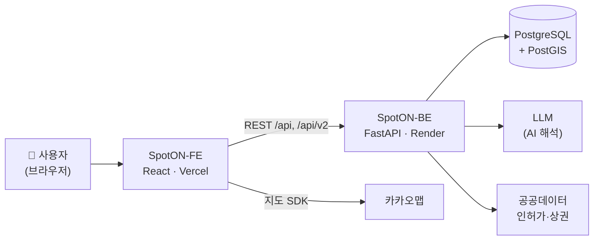

<div align="center">


계약하려는 주소 하나로 그 자리를 거쳐 간 점포의 이력과 주변 같은 업종의 생존 기록을 근거와 함께 보여주는<br>
**공공데이터 기반 창업 입지 진단 웹서비스**

[🌐 서비스 바로가기](https://spot-on-fe-two.vercel.app) · [💻 프론트엔드 저장소](https://github.com/sigoreu-jabeujong/SpotON-FE) · [⚙️ 백엔드 저장소](https://github.com/sigoreu-jabeujong/SpotON-BE) · [📚 문서 모음](docs/README.md)


</div>

---

## 목차

1. [접속 주소](#1-접속-주소)
2. [프로젝트 소개](#2-프로젝트-소개)
3. [주요 기능](#3-주요-기능)
4. [작동 방법](#4-작동-방법)
5. [실행 파일 · URL](#5-실행-파일--url)
6. [실행 방법](#6-실행-방법)
7. [시스템 구성 · 기술 스택](#7-시스템-구성--기술-스택)
8. [폴더 구조](#8-폴더-구조)
9. [사용한 공공데이터](#9-사용한-공공데이터)
10. [팀 소개 · 협업 규칙](#10-팀-소개--협업-규칙)
11. [유의사항](#11-유의사항)

### 🎬 시연 영상

> 시연 영상(YouTube) 링크는 준비되는 대로 추가할 예정이에요.

---

## 1. 접속 주소

설치 없이 아래 주소로 바로 이용할 수 있어요. 회원가입은 필요하지 않아요.

| 구분 | 주소 |
|---|---|
| 🌐 **서비스(FE)** | **[https://spot-on-fe-two.vercel.app](https://spot-on-fe-two.vercel.app)** |
| ⚙️ 백엔드 API | [https://spoton-be-free.onrender.com](https://spoton-be-free.onrender.com) |
| 📖 API 문서 (Swagger) | [https://spoton-be-free.onrender.com/docs](https://spoton-be-free.onrender.com/docs) |
| 💚 서버 상태 | [health](https://spoton-be-free.onrender.com/api/health) · [ready](https://spoton-be-free.onrender.com/api/ready) |
| 💻 FE 저장소 | [github.com/sigoreu-jabeujong/SpotON-FE](https://github.com/sigoreu-jabeujong/SpotON-FE) |
| 🗄️ BE 저장소 | [github.com/sigoreu-jabeujong/SpotON-BE](https://github.com/sigoreu-jabeujong/SpotON-BE) |

> ⏳ 백엔드는 무료 서버라 한동안 사용이 없으면 잠들어요. **첫 접속은 30초~1분** 정도 걸릴 수 있어요. 시연 전에는 미리 한 번 열어 두는 걸 권장해요.

## 2. 프로젝트 소개

| 항목 | 내용 |
|---|---|
| 서비스 | **Spot:ON(스팟온)** — 창업 입지(자리) 진단 공공서비스 |
| 대상 | 서울특별시에서 **카페·음식점**(한식·중식·일식·양식) 창업을 준비하는 **만 18세 이상 예비창업자** |
| 문제 | 계약 전에 "이 자리에 어떤 가게가 있었고, 주변 가게는 얼마나 버텼는지" 확인할 방법이 마땅치 않아요 |
| 해결 | 인허가·상권 공공데이터로 **과거 점포 이력 · 주변 동일 업종 현황 · 참고지표 · AI 해석**을 한 흐름으로 보여줘요 |
| 원칙 | 자체 점수·등급 없이, 모든 수치를 **출처·기준일·공간 단위와 함께** 보여줘요 |
| 소속 | 2026 청년 공공AX 서포터즈 · 팀 **시고르자브종** |

## 3. 주요 기능

| ID | 기능 | 설명 |
|---|---|---|
| F-01 | 주소·업종 입력 | 서울 주소 검색, 후보 자동 선택, 상세주소(층·호) 반영, 카페/음식점 선택 |
| F-02 | 과거 점포 이력 | 같은 건물·층에 있었던 점포의 개업·폐업일과 영업 기간 (영업 중 점포 포함) |
| F-03 | 주변 동일 업종 지도 | 반경 안 같은 업종 점포를 카카오 지도에 영업 중/폐업으로 표시 |
| F-04 | 세부 필터 | 반경 300/500/1,000m, 음식점 세부 업종, 시설 규모 |
| F-05 | 시점 조회 | 1·3·5년 전 등 과거 시점에 있던 점포가 지금도 영업 중인지 확인 |
| F-06 | 점포 변동·상권 활동 | 최근 12개월 개업·폐업 수, 평균 영업 기간, 연도별 개업·폐업 추이 |
| F-07 | 정량지표 | 서울시 **공식 지표**와 **Spot:ON 참고지표**(폐업률·1·3주년 생존율·동종업체 수)를 나눠 표시, 서울 평균과 비교 |
| F-08 | AI 해석 | 버튼을 누를 때만 요청. 서버가 검증한 **이점 · 유의점 · 수치 해석**과 **계약 전 확인사항** 제공 |
| F-09 | 결과 저장 | 진단 조건·결과를 담은 **PDF 진단서** 저장 |
| F-10 | 상담 연결·재진단 | 관할 지역센터 전화번호, 공공 창업상담·소상공인 지원사업 바로가기, 조건 바꿔 다시 진단 |
| + | 위치 참고자료 | 인근 상권 점포당 추정매출(점포 수 상위 3개 상권), 생활인구 주간·야간 비교 |

## 4. 작동 방법

랜딩 → **STEP 01** 입력 → **STEP 02** 분석 → **STEP 03** 종합 진단 → **STEP 04** 저장·상담 순서로 진행해요.
아래 화면은 실제 공공데이터(기준일 2026.11.08)로 찍은 데스크톱 1440×900 화면이에요.

### ① 랜딩 — 진단 시작


1. [서비스 주소](https://spot-on-fe-two.vercel.app)에 접속해요.
2. **서비스 소개 보기**로 Spot:ON이 무엇을 보여주는지 확인할 수 있어요.
3. **진단 시작하기**를 누르면 STEP 01로 이동해요.

### ② STEP 01 — 주소·업종 입력


1. 창업을 고민하는 **서울 주소**를 입력해요. 예: `서울 마포구 양화로 45 2층`
   - 도로명·건물번호가 정확히 맞는 후보가 하나면 **자동으로 선택**돼요. 후보가 여러 개면 목록에서 골라요.
   - 건물번호 뒤에 층·호를 함께 쓰면 그 층·호 기준으로 이력을 찾아요.
   - 서울 밖 주소는 분석하지 않고 안내만 보여줘요.
2. 업종을 골라요. **카페** 또는 **음식점**(한식·중식·일식·양식, 여러 개 선택 가능)이에요.
3. **이 자리 진단하기**를 누르면 STEP 02로 이동해요.

### ③ STEP 02 — 입지 정보 분석


왼쪽 메뉴로 세 부분을 오갈 수 있어요.

| 부분 | 볼 수 있는 것 | 할 수 있는 것 |
|---|---|---|
| **과거 점포 이력** | 같은 건물·층을 거쳐 간 점포의 상호, 개업·폐업일, 영업 기간, 상태 | 가까운 순/영업 기간 순 정렬 |
| **주변 점포 분석** | 반경 안 같은 업종 점포 지도·목록 (영업 중/폐업 색 구분) | 반경·세부 업종·시설 규모 필터, **과거 시점 조회**(그때 있던 점포가 지금도 영업 중인지) |
| **상권 활동** | 최근 12개월 개업·폐업 수, 평균 영업 기간, 연도별 추이, 인근 상권 추정매출, 생활인구 주간·야간 | ⓘ를 눌러 계산 기준 확인, 표로 보기 |

- 위쪽 **진단 조건 바**에서 **조건 바꾸기**를 누르면 주소·업종·반경을 바로 바꿀 수 있어요.
- 모든 수치 아래에 **출처·기준일·공간 단위(반경/상권/행정동)**가 함께 표시돼요. 자료가 없으면 0 대신 "정보 없음"과 사유를 보여줘요.
- 진단 조건은 주소창(URL)에 담겨 있어서 **새로고침하거나 링크를 공유해도 그대로** 유지돼요.

### ④ STEP 03 — 종합 진단 결과 · AI 해석

| | |
|:---:|:---:|
|  |  |
| **종합 진단 결과** | **AI 해석** |

1. **Spot:ON 참고지표**와 **서울시 공식 지표**를 영역을 나눠 보여줘요. 둘은 기간·공간 단위가 달라 직접 비교하지 않아요. 공식 지표는 해당 상권 자료가 있을 때만 파란 영역으로 나타나요.
2. 참고지표 카드에서 **참고 폐업률 · 개업 1·3주년 생존율 · 반경 안 동종업체 수**를 확인해요. **서울 평균과 비교** 막대로 이 자리 값과 서울 전체 값을 나란히 볼 수 있어요.
3. **AI 해석 보기**를 누르면 현재 조건으로 AI 해석을 요청해요. 자동으로 요청하지 않아요.
   - **이점 · 유의점**을 나란히, 그 아래 **수치 해석과 근거**, **계약 전 확인사항**을 보여줘요.
   - 서버가 계산·검증한 지표만으로 문장을 만들고, 검증에 실패하면 문장을 보여주지 않아요.
   - AI 해석이 실패해도 지표는 그대로 볼 수 있어요.

### ⑤ STEP 04 — 결과 저장 · 상담 연결


1. **PDF로 결과 저장** 카드에서 **PDF로 저장 (인쇄)**를 누르면 브라우저 인쇄 창이 열려요. 대상(프린터)에서 **PDF로 저장**을 고르면 진단 조건·이력·지표·참고자료가 담긴 진단서가 저장돼요. STEP 03에서 받은 AI 해석도 함께 담겨요.
2. **공공 창업 상담센터**에서 관할 지역센터 전화번호를 누르면 바로 전화를 걸 수 있어요(휴대폰).
3. **소상공인 지원사업**의 **바로가기**로 공식 사이트에 이동해요. 모집 기간·지원 조건은 연결된 공식 사이트에서 확인해 주세요.
4. 다른 주소를 보려면 맨 아래 **다른 자리도 궁금하신가요?** 카드를 눌러 STEP 01로 돌아가요.

<details>
<summary><b>화면 경로 한눈에 보기</b></summary>

| 경로 | 단계 | 화면 |
|---|---|---|
| `/` | — | 랜딩 |
| `/diagnose` | STEP 01 | 주소·업종 입력 |
| `/result/analysis` | STEP 02 | 과거 점포 이력(`#history`) · 주변 점포 분석(`#nearby`) · 상권 활동(`#activity`) |
| `/result/summary` | STEP 03 | 종합 진단 결과 + AI 해석 |
| `/result/share` | STEP 04 | PDF 진단서 저장, 상담 연결 |
| `/result/report` | 인쇄 | 인쇄용 진단서 |

</details>

## 5. 실행 파일 · URL

브라우저로 이용하는 웹서비스라 별도 설치 파일(`.exe`)은 없어요. **실행에 필요한 소스·설정 파일과 접속 URL을 저장소에 함께 등록**했어요.

### 등록된 실행 파일

| 구분 | 파일 | 역할 |
|---|---|---|
| FE 진입점 | [index.html](index.html) · [src/main.tsx](src/main.tsx) | 웹 앱 시작점 |
| FE 의존성 | [package.json](package.json) · [package-lock.json](package-lock.json) | 실행·빌드 명령과 패키지 버전 고정 |
| FE 환경 설정 | [.env.example](.env.example) · [.env.production.example](.env.production.example) | 환경변수 예시 (실제 `.env`는 커밋하지 않음) |
| FE 배포 설정 | [vercel.json](vercel.json) · [scripts/build-vercel.mjs](scripts/build-vercel.mjs) | Vercel 빌드·새로고침 대응 |
| BE 진입점·의존성 | [app/main.py](https://github.com/sigoreu-jabeujong/SpotON-BE/blob/develop/app/main.py) · [pyproject.toml](https://github.com/sigoreu-jabeujong/SpotON-BE/blob/develop/pyproject.toml) · [uv.lock](https://github.com/sigoreu-jabeujong/SpotON-BE/blob/develop/uv.lock) | API 서버 시작점과 패키지 고정 |
| BE 환경·DB·배포 | [.env.example](https://github.com/sigoreu-jabeujong/SpotON-BE/blob/develop/.env.example) · [compose.yaml](https://github.com/sigoreu-jabeujong/SpotON-BE/blob/develop/compose.yaml) · [Dockerfile](https://github.com/sigoreu-jabeujong/SpotON-BE/blob/develop/Dockerfile) | 로컬 DB 컨테이너, 배포 이미지 |

### 등록된 URL

| 구분 | URL | 등록 위치 |
|---|---|---|
| 서비스 | https://spot-on-fe-two.vercel.app | 이 README, 저장소 About, [index.html](index.html) 공유 미리보기 |
| 백엔드 API | https://spoton-be-free.onrender.com | 이 README, Vercel 환경변수 `VITE_API_BASE_URL` |
| API 문서 | https://spoton-be-free.onrender.com/docs | 이 README |
| FE · BE 저장소 | https://github.com/sigoreu-jabeujong/SpotON-FE · https://github.com/sigoreu-jabeujong/SpotON-BE | 이 README, 서비스 하단 푸터 |

> `dist/`(빌드 결과물)와 가상환경은 아래 명령으로 만들어요. 실제 `.env`, 인증키, 비밀번호, 원천 데이터는 저장소에 올리지 않아요.

## 6. 실행 방법

| 방법 | 필요한 것 | 언제 쓰나요 |
|---|---|---|
| **A. 바로 이용** | 웹 브라우저 | 설치 없이 실제 서비스 확인 → [접속 주소](#1-접속-주소) |
| **B. FE만 로컬 실행 (목업)** | Node.js **24 권장**(최소 22.22.0), npm, Git | 백엔드 없이 예시 데이터로 화면 확인 |
| **C. FE 로컬 + 운영 BE** | B와 같음 (+ 지도용 카카오 JavaScript 키) | 실제 데이터로 로컬 화면 확인 |
| **D. FE + BE 모두 로컬** | B + Python **3.11**, uv **0.13.7**, Docker Desktop | 서버·DB까지 직접 실행 |

### 6-1. FE 로컬 실행 (B · C)

```bash
# 1. 저장소 받기
git clone https://github.com/sigoreu-jabeujong/SpotON-FE.git
cd SpotON-FE

# 2. 패키지 설치
npm ci

# 3. 환경변수 파일 만들기 (Windows PowerShell: Copy-Item .env.example .env)
cp .env.example .env

# 4. 개발 서버 실행 → 터미널에 나온 주소(기본 http://localhost:5173)로 접속
npm run dev
```

`.env`는 실행 방법에 따라 이렇게 바꿔요. 바꾼 뒤에는 개발 서버를 다시 시작해요.

| 항목 | B. 목업 | C. 운영 BE 연결 | D. 로컬 BE 연결 |
|---|---|---|---|
| `VITE_USE_MOCK` | `true` | `false` | `false` |
| `VITE_API_BASE_URL` | (호출 안 함) | `https://spoton-be-free.onrender.com` | `http://localhost:8000` |
| `VITE_ANALYSIS_API_VERSION` | `v1` | `v2` | `v1` (v2 데이터 준비 시 `v2`) |
| `VITE_KAKAO_JS_KEY` | 선택 (없으면 지도 자리에 안내) | 지도 확인 시 필요 | 지도 확인 시 필요 |

- 목업은 [src/api/mocks/](src/api/mocks/)의 예시 응답이고 실제 공공데이터가 아니에요.
- 운영 BE 연결은 BE의 `CORS_ORIGINS`에 로컬 주소가 허용돼 있어야 해요. 안 되면 목업(B)이나 로컬 BE(D)로 확인해요.
- 카카오 지도는 [카카오 개발자 콘솔](https://developers.kakao.com)에 접속 주소(예: `http://localhost:5173`)를 등록해야 보여요.

### 6-2. BE 로컬 실행 (D)

FE와 같은 상위 폴더에서 **새 터미널**을 열어 실행해요. (Windows PowerShell 기준)

```powershell
git clone https://github.com/sigoreu-jabeujong/SpotON-BE.git
Set-Location SpotON-BE
py -3.11 -m pip install uv==0.13.7
$env:UV_NO_EDITABLE = "1"          # 한글 경로 인코딩 오류 방지
uv sync --locked --extra dev
Copy-Item .env.example .env        # 처음 한 번만. 값은 BE README 참고

# Docker Desktop 실행 후 DB 준비 → 테이블 생성
docker compose up -d --wait db
uv run --locked --extra dev alembic upgrade head

# API 서버 실행 → http://localhost:8000/docs
uv run --locked --extra dev uvicorn app.main:app --reload --no-access-log
```

- DB를 만든 것만으로는 분석 데이터가 채워지지 않아요. 원천 데이터 적재(ETL)와 BE `.env` 값(주소 검색 키, AI 키 등)은 [BE README](https://github.com/sigoreu-jabeujong/SpotON-BE/blob/develop/README.md)를 따라 주세요.
- 종료할 때는 각 터미널에서 `Ctrl+C`, DB는 `docker compose stop db`로 멈춰요. 데이터는 그대로 남아요.

### 6-3. 연결 확인

1. [로컬 health](http://localhost:8000/api/health)가 `{"data":{"status":"ok"},"meta":{},"error":null}`을 보여주는지 확인해요.
2. FE `.env`를 D 설정으로 바꾸고 FE를 실행해요.
3. 서울 주소 검색 → STEP 02 이력·지도·지표 → STEP 03 AI 해석 → STEP 04 PDF 저장 순서로 확인해요.

### 6-4. 빌드 · 결과물 확인

```bash
cp .env.production.example .env.production   # 실제 BE 주소·지도 키 설정
npm run build                                # 타입 검사 + 빌드 → dist/
npm run preview -- --port 5180               # http://localhost:5180 에서 결과 확인
```

`main` 브랜치에 병합되면 Vercel이 자동으로 빌드·배포해요. 자세한 내용은 [배포 안내](docs/deploy.md)에 있어요.

### 명령어

| 명령어 | 설명 |
|---|---|
| `npm run dev` | 개발 서버 실행 |
| `npm run build` | 타입 검사 + 배포용 빌드 |
| `npm run preview -- --port 5180` | 빌드 결과 미리보기 |
| `npm run test` | 단위 테스트 (Vitest) |
| `npm run lint` | 코드 검사 (ESLint) |
| `npm run format` / `npm run format:check` | 코드 자동 정리 / 정리 상태 확인 (Prettier) |

PR을 올리면 GitHub Actions가 **설치 → 린트 → 단위 테스트 → 빌드**를 자동으로 검사해요.

### 문제 해결

| 증상 | 확인할 것 |
|---|---|
| 첫 접속이 느려요 | 무료 BE가 깨어나는 중이에요. 30초~1분 뒤 다시 확인해 주세요 |
| "서버에 연결할 수 없어요" | BE 실행 여부, `VITE_API_BASE_URL`, BE `CORS_ORIGINS`에 FE 주소가 있는지 |
| 주소 검색이 안 돼요 | 서울 주소인지, BE 주소 검색 키가 설정됐는지 |
| 지도만 안 보여요 | `VITE_KAKAO_JS_KEY`와 카카오 콘솔의 허용 도메인 |
| AI 해석이 안 나와요 | BE AI 키·한도, 표본 부족·검증 실패 안내 문구 |
| 설정을 바꿨는데 그대로예요 | 개발 서버 재시작 또는 다시 빌드 |

<details>
<summary><b>목업 모드에서 상황별로 확인하는 입력값</b></summary>

| 입력 | 결과 |
|---|---|
| 주소에 `없는` | 주소를 찾지 못함 |
| 주소에 서울 외 지역명 (예: `경기도`) | 서울 외 주소 안내 |
| 주소에 `여러` | 주소 후보 목록 |
| 반경 300m | 표본 부족(판단 보류), AI 해석 검증 실패 |
| 반경 1,000m | AI 해석 실패 |
| 건물 키(`bk`)에 `missing` / `empty` / `error` | 이력 결측 / 0건 / 오류 |

</details>

## 7. 시스템 구성 · 기술 스택



- 모든 API 응답은 `{ data, meta, error }` 형식이고, `meta`에 출처·기준일·공간 단위가 담겨요 → [API 계약](docs/api-contract.md)
- **프론트에서는 지표를 계산하지 않아요.** 서버가 준 값을 형식만 바꿔 보여줘요 → [화면 표시 원칙](docs/display-rules.md)

| 구분 | 사용 기술 |
|---|---|
| FE | React 19, TypeScript, Vite, Tailwind CSS v4, React Router, TanStack Query |
| 지도 · 차트 | 카카오맵 JavaScript SDK, recharts |
| FE 품질 | ESLint, Prettier, Vitest, GitHub Actions |
| BE | Python 3.11, FastAPI, Pydantic, SQLAlchemy, Alembic |
| DB | PostgreSQL + PostGIS |
| AI | LLM API — 현재 OpenAI, Google Gemini 호환 유지 (서버에서만 호출) |
| 배포 | FE: Vercel / BE: Render · Docker |

## 8. 폴더 구조

```text
SpotON-FE/
├── .github/workflows/     # CI (린트 → 테스트 → 빌드)
├── docs/                  # 팀 문서 (API 계약, 화면 요구사항, 표시 원칙, 결정 사항 등)
│   └── images/            # README 화면 캡처
├── public/                # 파비콘, 공유 미리보기 이미지
├── scripts/               # Vercel 배포용 빌드 스크립트
├── src/
│   ├── pages/             # 화면 단위 컴포넌트 (라우트 1개 = 파일 1개)
│   ├── components/
│   │   ├── landing/       # 랜딩
│   │   ├── input/         # STEP 01 주소 검색·업종 선택
│   │   ├── analysis/      # STEP 02 이력·주변 점포·상권 활동·참고자료
│   │   ├── map/           # 카카오 지도
│   │   ├── summary/       # STEP 03 지표 카드·서울 평균 비교·AI 해석
│   │   ├── share/         # STEP 04 PDF 진단서·상담 연결
│   │   ├── layout/        # 헤더·사이드바·진단 조건 바·푸터
│   │   └── common/        # 공통 UI
│   ├── api/               # 백엔드 호출 함수 (mocks/: 목업 응답)
│   ├── hooks/             # 커스텀 훅 (진단 조건 URL 유지 등)
│   ├── types/             # API 응답 타입
│   ├── constants/         # 진단 조건, 상태 라벨, 화면 문구
│   ├── utils/             # 날짜·숫자 형식 등 순수 함수 (지표 계산 없음)
│   ├── assets/            # 이미지
│   ├── router.tsx         # 화면 경로
│   └── main.tsx           # 앱 시작점
├── vercel.json            # Vercel 설정
└── package.json
```

더 자세한 문서는 [문서 모음](docs/README.md)에 있어요. ([API 계약](docs/api-contract.md) · [화면 요구사항](docs/screens.md) · [표시 원칙](docs/display-rules.md) · [결정 사항](docs/decisions.md) · [접근성](docs/accessibility.md) · [배포](docs/deploy.md) · [시연 대본](docs/demo.md))

## 9. 사용한 공공데이터

화면에 표시되는 출처 번호(R번호)와 같아요. 전체 표는 [화면 표시 원칙 7장](docs/display-rules.md#7-출처-번호-표)에 있어요.

| 번호 | 데이터 | 제공 |
|---|---|---|
| R5 · R6 | [일반음식점](https://www.data.go.kr/data/15154916/openapi.do) · [휴게음식점](https://www.data.go.kr/data/15154921/openapi.do) 인허가 | 행정안전부 |
| R1 · R11 | [서울시 상권분석서비스](https://golmok.seoul.go.kr/stateDistrict.do) · [창업위험도 산정 방식](https://golmok.seoul.go.kr/images/seoul_info.pdf) | 서울신용보증재단 |
| R2 · R15 | [점포-상권](https://data.seoul.go.kr/dataList/OA-15577/F/1/datasetView.do) · [영역-상권](https://data.seoul.go.kr/dataList/OA-15560/S/1/datasetView.do) | 서울 열린데이터광장 |
| R3 · R4 · R16 | [추정매출-상권](https://data.seoul.go.kr/dataList/OA-15572/S/1/datasetView.do) · [생활인구 250m 격자](https://data.seoul.go.kr/dataList/OA-22784/S/1/datasetView.do) · [상권변화지표](https://data.seoul.go.kr/dataList/OA-15576/S/1/datasetView.do) | 서울 열린데이터광장 |
| R19 | [주소](https://www.data.go.kr/data/15057017/openapi.do) · [좌표](https://www.data.go.kr/data/15056663/openapi.do) API | 행정안전부 |
| R8 | [카카오 로컬](https://developers.kakao.com/docs/latest/ko/local/dev-guide) · [지도](https://apis.map.kakao.com) | 카카오 |
| R17 | 창업상담·소상공인 지원기관 링크 | 서울시 자영업지원센터 외 |
| R18 | AI 해석 문장 구성 | LLM API (현재 OpenAI) |

## 10. 팀 소개 · 협업 규칙

| 이름 | 역할 | 담당 |
|---|---|---|
| 권민수 | 팀장 · PM | 기획 총괄, 일정 관리 |
| 윤희은 | UI/UX | 화면 디자인 |
| 류민지 | Frontend | 웹 화면 전체 개발·배포 |
| 최호림 | Backend | 서버·DB·API, 배포 |
| 김승은 | Backend | AI 해석·데이터 |

| 항목 | 규칙 |
|---|---|
| 브랜치 | `main`(배포) ← `develop`(통합) ← `feat/` `fix/` `docs/` `style/` `chore/` |
| 작업 단위 | 기능 하나 = 브랜치 하나 = PR 하나, `main`·`develop` 직접 push 금지 |
| 커밋 | `타입: 내용` — `feat` `fix` `refactor` `perf` `docs` `style` `chore` |
| PR 전 확인 | `lint` · `format:check` · `build` · `test` 통과 |
| 개발 규칙 | [CLAUDE.md](CLAUDE.md) |

## 11. 유의사항

- Spot:ON의 결과는 공공데이터 기반 **참고 정보**예요. 창업의 **성공·실패를 판정하지 않으며**, 사업주의 역량은 반영하지 않아요.
- **폐업은 행정상 신고 기록 기준**이라 실제 영업 종료 시점과 다를 수 있어요.
- 추정매출은 상권 단위 **추정치**이며 실제 매출이 아니에요. 생활인구는 공개자료 기준 참고값이에요.
- AI 해석은 서버가 계산·검증한 지표만으로 만든 참고 문장이며, 전문적인 조언을 대신하지 않아요.
- 회원가입 없이 이용하며 개인정보를 저장하지 않아요.
