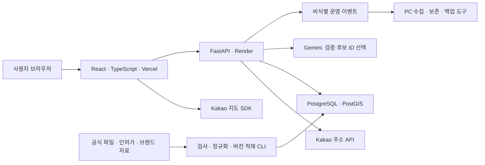

# Spot:ON 개발 결과 보고서 작성용 종합 분석 자료

작성 기준일: **2026-11-16, Asia/Seoul** · 관련 이슈: #193

이 문서는 최종 제출용 결과 보고서의 **근거 자료집**이다. 현재 FE·BE 코드, 실제 CI, 배포 실행 기록과 직접 확인한 공개 응답을 대조했다. 구현·운영 반영·과거 검증·설계·미확인을 구분하며, 사용 성과나 사업 효과를 임의로 만들지 않는다.

**작성 중 변경 보충:** 최초 분석 이후 BE PR201과 FE PR92가 병합됐다. 최종 추가 대조는 BE `e578692` / FE develop `a61be02` / FE main `7231476` 기준이며, 점포당 참고 평균·추가 FE 보완과 새 CI 결과는 **23절**에 따로 기록했다. 아래 초기 기준과 실제 운영 배포 증거를 이 새 개발 커밋으로 소급하지 않는다.

## 1. 분석 기준과 증거의 범위

| 구분 | 확인한 기준 | 해석 |
| --- | --- | --- |
| BE 초기 분석 develop | `67737fa79dfd19ceb69ada6094fd2ac4fc265f1a` | #192까지 반영. 이후 개발 변경은23절 |
| BE 최신 기능/공개 배포 기록 | `0ac3bf6c905fe217139116f39bbd5e5f16d91a07` / PR191 | #190 행정동 참고자료 실제 연결, migration0013 |
| FE 초기 분석 develop | `80aaba21d21ea9cac86d007d767594c302312d41` | 기능PR86·브랜드 필터PR87 포함 |
| FE 초기 공개 main | `3842d636469e42e6aa58a9cc4fc77a774237d5a7` / release PR88 | 초기 분석 당시 develop과 파일 차이 없음. 후속은23절 |
| 사용자의 로컬 BE 체크아웃 | `c2becd4`, develop | 분석 시작 당시 최신 develop보다2커밋 이전. 원래 파일/환경 보존 |
| 사용자의 로컬 FE 체크아웃 | `5959752`, develop | 분석 시작 당시 원격 develop보다17커밋 이전. 코드 분석은 별도 최신 snapshot으로 수행 |
| 분석 방법 | 소스·문서 읽기, GitHub PR/CI 조회, 오프라인 OpenAPI/ORM 구성 검사, 공개 URL 단발 확인 | 운영 DB 전체 재조회나 모든 화면 재검증을 이번에 수행한 것은 아님 |

최신 상태는 날짜가 뒤인 실제 구현/검증 기록과 소스가 우선한다. 예전 README·설계의 “미구현”, “목업만 완료”, “schema0012”를 현재 상태로 그대로 복사하지 않는다. 문서 사이의 차이는 19절에 정리했다.

### 직접 확인한 공개 응답

| 대상 | 이번 확인 | 보장하지 않는 것 |
| --- | --- | --- |
| `https://spot-on-fe.vercel.app` | HTTP200, HTML 수신, 표본0.171초 | 전체 브라우저 흐름·모든 API 성공 |
| `https://spoton-be-free.onrender.com/api/ready` | HTTP200, status=ok, 표본3.125초 | 상시 가용성·모든 데이터셋의 공식 정확성 |
| 같은 BE의 `/openapi.json` | HTTP200, 표본3.171초, GET/POST20개. 소스의 경로/메서드 목록과 일치 | 모든 endpoint의 업무 응답을 이번에 호출했다는 뜻 아님 |

세 요청은 단발·병렬 표본이다. 벤치마크·평균 지연·SLA·절전 복귀 시간으로 사용하지 않는다. 비밀키나 DB 접속정보를 읽거나 공개하지 않았다.

## 2. 프로젝트 개요와 개발 목표

| 항목 | 보고서에 사용할 내용 |
| --- | --- |
| 이름 | Spot:ON(스팟온), 공공데이터 기반 창업 입지 진단 웹서비스 |
| 팀/활동 | 시고르자브종 / 청년 공공AX 서포터즈. 구성원·역할·공식 활동명은 팀 최종 명단으로 확인 |
| 대상 | 서울에서 카페 또는 음식점 창업을 준비하는 예비 창업자. 서비스 소개의 성인 대상 표현은 실제 연령 인증 기능과 구분 |
| 문제 | 계약 전 동일 주소의 과거 점포, 주변 업종의 변화, 자료 기준과 한계를 한 흐름으로 확인하기 어려움 |
| 제공 가치 | 주소 입력→이력/주변/시점 분석→검증된 참고지표·AI 설명→진단서/상담 연결 |
| 지원 업종 | 카페, 음식점의 한식·중식·일식·양식 |
| 지원 지역 | 서울특별시. 서울 외 지오코딩 결과는 차단 |
| 핵심 원칙 | 자체 성공 확률·위험점수·위험등급·추천 순위를 생성하지 않고 출처·시간·공간·분모·한계를 표시 |
| 성격 | 창업 의사결정 참고 도구. 실제 임대차/현재 입점 확인·매출 보장·폐업 원인 판정·지원사업 자격 확정 기능은 아님 |

문제 정의는 팀이 설정한 개발 배경이다. 이용자 조사나 시장 검증을 완료한 결과로 표현하려면 별도 조사 자료가 필요하다.

## 3. 기능별 개발 결과

| 기능 | FE 구현 | BE/데이터 구현 | 현재 평가와 제한 |
| --- | --- | --- | --- |
| F-01 주소·업종 입력 | 검색·후보 선택·서울 외/검색 실패 안내 | Kakao 주소 검색, 좌표/지번키/명시 층·호 추출 | 실제 연결. 상세주소 복원·후보 확정 UX 결함은 #195에서 재현/설계 |
| F-02 점포 이력 | 이력 표·영업기간·위치 구분·브랜드 추정 | 같은 주소 키의 지원 업종 전체 이력, source+license_no 식별 | 건물 주소 범위/같은 자리 구분. 동일 층 별도 관계는 미구현 |
| F-03 주변 업종 지도 | Kakao 지도·마커·표 선택 연동 | geography 거리 반경의 시점별 점포 | 좌표 확보 기록 기준. 표를 키보드 대체 경로로 제공 |
| F-04 조건 필터 | 반경·세부 업종·면적·브랜드 조건 | 동일 모집단 조건을 주변/상태/활동/Risk/AI에 적용 | 공개 v2 화면의 브랜드 선택은 전체/브랜드·체인 두 가지 |
| F-05 과거 시점 조회 | 조회 가능한 월·과거 선택·상태 비교 | 과거 존재 코호트를 최신 상태로 분해 | 현재 보관된 날짜로 역사 재구성. 완전한 과거 원장 복원 아님 |
| F-06 활동 분석 | 개폐업·연도별 차트·운영 개월 | 최근12개월, 같은 월일YTD, 영업 중 기록의 평균 경과 개월 | 연도별 추이는2010년부터. 원본 코호트는 그 이전도 유지 |
| F-07 정량 참고지표 | 참고 폐업률·1/3주년 생존율·서울 비교 | 정해진 코호트/분모/소표본/반올림 규칙 | 공식 폐업률·창업위험도는 제거. 선택 상권변화·전체 인구 보류는 유지 |
| 위치 참고자료 | 기존 분석/종합/보고서의 매출·인구·주야간3카드 | 위치 포함/반경 교차 상권 및 행정동 원자료 연결 | 공개 배포 기록 있음. 실제 구역·자료 시점·미적용 필터를 표시 |
| 점포당 참고 평균 | FE develop에 공통 카드 추가 | BE develop의location-reference에동일분기원천행가중집계추가 |작성중PR201/FE92병합.새코드의운영배포는미확인,23절참고 |
| 격자 부분 인구 비교 | 원천별 공개부분 상세 카드·보고서 | 동일 공개 구성24시간 비교, 원천별 partial/no_data | 전체 인구와 분리. 새 행정동 참고자료와도 다른 계약 |
| F-08 AI 설명 | 수동 요청,4문단 plain text, 정보창·체크리스트 | 서버 재계산·문장 후보 선택·숫자/출처 검증·공유 한도 | v2는 격자 공개부분 근거 포함. 새 행정동/매출 참고값은 AI에 넣지 않음 |
| F-09 저장·공유 | A4 인쇄/PDF,1080×1350 PNG, URL 조건 보존 | 별도 PDF 서버 API 없이 현재 응답/검증된 해석 재사용 | 선택 상권 수에 따라 PDF 쪽수 증가. 영구 서버 저장소 기능 아님 |
| F-10 상담 연결 | 관할 센터·공식 지원 링크·재진단 | 공통 링크 카탈로그+관할 연락처 우선 | 개인별 지원사업 자격·업종별 추천 순위는 제공하지 않음 |
| 운영·품질 기반 | 배포 프로필·취소/캐시·독립 오류 영역 | 준비 검사·조회 권한·원천/세대 가드·로그·백업 도구 | PC 로그 시범 운영과 원격 백업 완료는 구분 |

이 표의 행 수로 전체 기능 완성률을 계산하지 않는다. 선택 기능·설계·운영 조건의 범위가 달라 단순한 백분율이 적절하지 않다.

## 4. 화면과 사용자 흐름

| 경로 | 역할 | 대표 산출물 |
| --- | --- | --- |
| `/` | 랜딩 | 서비스 소개·이용 방법·데이터 출처·진단 시작 |
| `/diagnose` | STEP01 | 주소·업종 입력, 복수 후보 선택 |
| `/result/analysis` | STEP02 | `#history`·`#nearby`·`#activity`, 조건·과거시점·참고자료 |
| `/result/summary` | STEP03 | 참고지표, 서울 비교, AI 설명과 체크리스트 |
| `/result/share` | STEP04 | 요약 이미지·PDF 진단서 열기·상담 링크·재진단 |
| `/result/report` | 별도 인쇄 경로 | A4 지면·현재 조건/자료·AI·참고자료를 인쇄/PDF 저장 |

좌표·주소·건물키·층/호·업종·반경·면적·시점·브랜드 조건은 URL과 Query 상태에서 관리한다. 새로고침/공유가 가능하지만 URL 자체가 위치 정보를 포함한다. 회원 계정 기반의 영구 보고서 보관·사용자 이력 저장과는 다르다.

## 5. 시스템 구조와 기술 선택

| 계층 | 실제 기술 | 선택 이유를 설명할 때 사용할 근거 |
| --- | --- | --- |
| FE | React19, TypeScript5.9, Vite8 | 컴포넌트·타입 계약·분리 빌드 |
| UI | Tailwind CSS4, Pretendard, Lucide | 공통 토큰·레이블·반응형 구성 |
| 상태/차트 | React Router8, TanStack Query5, Recharts3 | 조건 URL·요청 취소/캐시·연도별 시각화 |
| 출력 | html2canvas1.4, 브라우저 print | 별도 PDF 생성 서버 없이 이미지/PDF 출력 |
| BE | Python3.11, FastAPI0.162.2, Pydantic2.14.3 | 공통 응답·엄격 입력/출력 검증·OpenAPI |
| DB 접근 | SQLAlchemy2.1.8, psycopg3.3.8, GeoAlchemy2 | 읽기 전용 트랜잭션·공간 SQL |
| 공간/변환 | PostGIS, pyproj3.7.2, pyshp3.1.8 | 거리·포함/교차·좌표계·SHP 검사 |
| 스키마 | Alembic1.20.1, 현재 head0013 | 버전 가드와 백업/복원 기반 전환 |
| AI/통신 | Google Gemini, httpx0.28.1 | 공급자 어댑터·시간 예산·비밀/URL 로그 억제 |
| 품질 | Vitest/ESLint/tsc, pytest/ruff/mypy, CodeQL | 자동 회귀·정적 검사·실제 PostGIS 및 Windows 검사 |
| 의존성 관리 | FE package-lock.json, BE uv.lock | 재현 가능한 의존성 설치 |

FE 버전의 정확한 patch는 package-lock, BE는 pyproject/uv.lock을 기준으로 한다. 비교 제품보다 우수하다는 성능 주장은 측정 근거가 없어 사용하지 않는다.

### 코드 탐색 지도

| FE 경로 | 내용 | BE 경로 | 내용 |
| --- | --- | --- | --- |
| `src/pages/` | 경로별 화면·보고서 | `app/routers/` | API 경계·쿼리 검증 |
| `src/components/` | 지도·이력·활동·지표·AI·출력 | `app/services/` | 조회·코호트·집계·버전/캐시 |
| `src/api/`, `src/types/` | fetch·v1/v2 투영·API 타입 | `app/schemas/` | 엄격한 입력/출력 계약 |
| `src/hooks/` | 조회/취소/조건·해석 상태 | `app/ai/` | 문맥·후보·프롬프트·검증 |
| `src/constants/`, `src/utils/` | 조건·문구·포맷·식별자 | `app/models/`, `migrations/` | 관계형/공간 모델·DDL |
| `scripts/` | production=v2 배포 프로필 검사 | `etl/` | 원천 적재·검사·브랜드 공개·운영 로그 CLI |

## 6. 공개 API 목록: 경로/메서드20개

문서 페이지·OPTIONS/CORS·정적 자산은 아래 개수에 포함하지 않았다. 공통 응답은 `{data, meta, error}`이며 오류/결측과 정상0을 구분한다.

| 메서드 | 경로 | 역할 |
| --- | --- | --- |
| GET | `/api/health` | 프로세스 상태 |
| GET | `/api/ready` | DB·스키마·조회 계정 준비 상태 |
| GET | `/api/geocode` | 서울 주소 후보·좌표·건물 주소 키·층/호 |
| GET | `/api/meta/data-range` | 업종별 조회 가능한 월 범위 |
| GET | `/api/stores/history` | legacy 건물 주소 범위 이력 |
| GET | `/api/stores/nearby` | legacy 반경/시점 점포 |
| GET | `/api/stores/snapshot` | legacy 과거 코호트의 최신 상태 |
| GET | `/api/market/activity` | legacy 최근/연도별 활동 |
| GET | `/api/risk` | legacy 참고지표 |
| POST | `/api/risk/interpret` | legacy 검증 AI 해석 |
| GET | `/api/support-links` | 공식 상담·지원 링크/관할 우선 |
| GET | `/api/v2/brands/status` | 브랜드 공개 세대/준비 상태 |
| GET | `/api/v2/stores/history` | v2 브랜드 근거를 포함한 이력 |
| GET | `/api/v2/stores/nearby` | v2 브랜드 조건의 주변 점포 |
| GET | `/api/v2/stores/snapshot` | v2 과거 코호트의 최신 상태 |
| GET | `/api/v2/market/activity` | v2 동일 조건의 활동 |
| GET | `/api/v2/risk` | v2 동일 조건의 참고지표 |
| POST | `/api/v2/risk/interpret` | v2 브랜드/부분 인구 근거의 검증 해석 |
| GET | `/api/v2/population-reference` | 원천별 격자 공개부분 주야간 비교 |
| GET | `/api/v2/location-reference` | 위치 포함/반경 교차 구역의 매출·행정동 참고자료 |

공통 조건은 업종·음식점 세부 업종·위치·반경300/500/1000m·조회월이다. 면적 구간은33㎡ 미만/33~66/66~99/99이상/전체다. 구간 경계는 이상·미만이며 결측 면적의 포함 여부를 구분한다.

v2는 legacy franchise 필터와 별도의 브랜드 조건을 사용한다. 인구/위치 참고 API는 허용된 최소 조건만 투영하며 브랜드·면적 필터를 인구에 적용하지 않는다. 지오코딩·월 범위·상담은 공통 경로를 사용한다.

## 7. 데이터 확보·적재·관리 결과

다음 건수는 기존 적재/원본 보존 및 배포 검증 기록에 근거한다. 이번 분석에서 운영 DB를 다시 세어 얻은 값은 아니다. 인허가·기존 상권·격자는 개발 DB 적재 기록이고, 행정동은 #190 clone/운영 실행 기록이다. 운영의 기존 표 해시 보존이 이번 분석의 새 전수 건수 측정을 뜻하지 않는다. 원자료 기준일·다운로드일·검증일·적재일·전체 수집 완료일을 혼용하지 않는다. 격자의2026-11-07과 행정동의2026-10-31은 모두 각 자료의 관측일이지만, 공간 단위와 제공 범위는 다르다.

| 데이터 | 용도 | 확보/적재 기록 | 현재 사용 범위 |
| --- | --- | --- | --- |
| 일반음식점 인허가 R5 | 점포·이력·개폐업 |541,169건 |지원 업종/날짜/좌표/제외정책에 맞는 분석 모집단 |
| 휴게음식점 인허가 R6 |카페 등 |148,271건 |지원 업종은카페. 원천 전체와 분석 대상은 다름 |
| 인허가 합계 |원본 점포 기반 |**689,440건** |일반+휴게 원본 합계, 반경의 현재 영업 점포 수가 아님 |
| 상권 경계 R15/OA-15560 |공간 포함/반경 교차 |1,650개 |검증된 파일 도형 기준. 모든 과거 분기의 공식 적용성 보증은 별도 |
| 점포-상권 R2/OA-15577 |공식 점포 통계 기반 |2025년4개 분기 합계24,810행 |원천/기간/업종 대응 검사. 공식 폐업률 카드로 연결하지 않음 |
| 추정매출-상권 R3/OA-15572 |위치별 원자료 금액 |14,391행 |실제 자료 분기와 원화 문자열. 월/분기 환산·반경 총매출 없음. 새 평균의 정의된 원천행 합계는23절참고 |
| 상권변화 R16/OA-15576 |유형 기반 |6,600행 |적재·내부 투영과 공개 활성화는 구분 |
| 250m 생활격자 |부분자료 공간 기준 |10,125개 |현재 파일/코드의 검증과 공식 역사 버전 보증을 구분 |
| 2026-11-07 격자 인구 R4 |원천별 공개부분 비교 |531,922행:내국인253,400·장기137,137·단기141,385 |공개 숫자/비공개/부재와 원천을 분리. 단일 전체 인구로 합치지 않음 |
| 브랜드 자료 |브랜드·체인 소속 추정 |공정위 카탈로그·소진공 snapshot·검토 seed/별칭 |가맹계약/직영/과거 소속의 확정이 아님 |
| 행정동 경계/내국인 인구 |새 위치 참고자료 |경계425개·2026-10-31 시간행10,128개 |422매칭 동의24시간. 미매칭5코드/120행 분리, 경계만 있는3동은자료없음 |

행정동 월 원천 검사는 CSV31개/317,688행을 확인했지만, 실제 연결에 적재한 관측은2026-10-31이다. 월 원천을 확보한 것과 모든 날짜를 현재 API에서 제공하는 것은 다르다.

### 데이터 검증/ETL의 주요 결과

- 파일 hash·헤더·행수·필수 코드·중복 키·날짜·비공개 표식·좌표계를 검사한다.
- 원천 버전과 내용 digest를 보존하며 재실행 no-op/동일 내용 재사용·원자적 적재·rollback을 검증한다.
- 공간 인덱스/좌표 변환과 원본 면적·도형을 구분한다. 임의 좌표 보완이나 미매칭 인구 행 생성은 하지 않는다.
- point-in-polygon은 경계 포함/중첩·반경 교차와 연결된 실제 구역을 반환한다. 가까운 구역의 값을 대체값으로 만들지 않는다.
- 브랜드 publication은 검토/버전·원천 변경 번호·활성 포인터로 공개 상태를 관리한다. 일반 API 조회 계정은 적재/관리 계정과 분리한다.
- 인허가 이름 키워드18개를 음식점 분석에서 제외하는 정책은 원본 분류의 수정이 아니라 **추정 제외**다. 치킨·통닭·호프·주점·포차·맥주·분식·김밥·떡볶·피자·카페·커피·cafe·coffee·베이커리·제과·빵집·bakery를 포함하며 카페와 이름null/빈 값은 유지한다. 오탐·미탐 가능성을 명시한다.

### 스키마 현황

현재 Alembic head는 **0013**. 소스 ORM 메타데이터 기준 업무/버전 테이블은 **28개**다. 운영 DB의 물리 표 수는 이번에 세지 않았다. 14절의 백업/원본 보존 표 개수는 실행 기록의 대상 집합으로, 이 ORM 개수와 합산하지 않는다.

| 영역 | 모델 테이블 |
| --- | --- |
| 점포 |stores, store_import_batches |
| 기존 가맹 |brand_catalog_versions, brands, brand_mapping_runs, brand_mapping_state, store_brand_matches |
| 브랜드 공개 |chain_source_state, chain_publications, chain_publication_state, chain_publication_brands, store_chain_classifications |
| 상권 |market_area_versions, market_areas, market_store_versions, market_stores, market_sale_versions, market_sales, market_change_versions, market_changes |
| 격자 인구 |living_grid_versions, living_grids, living_population_versions, living_population_observations |
| 행정동 인구 |admin_boundary_versions, admin_areas, admin_population_versions, admin_population_hours |

## 8. 핵심 분석 정의와 보고서 설명 기준

### 시점·모집단

- D: 검증된 전역 인허가 자료 갱신일. T: 요청월의 실제 분석 기준일. 최신 월은D, 과거 월은월말을 사용한다.
- `collected_at`은 원천 전체 수집 완료시각을 확인하지 못하면null이다. 적재일/검증일을 대신 넣지 않는다.
- 인허가 지원 날짜 기준은1960년부터지만 **연도별 차트만2010년부터** 반환한다.
- 폐업 기록은 사건/생존율 계산에서 필요하므로 전체 조회에서 무조건 제거하지 않는다. 좌표가 없는 기록은 반경 집계에 들어가지 않으며 제외 건수의 범위를 표시한다.

| 지표 | 현재 계산/표현 | 피해야 할 해석 |
| --- | --- | --- |
| 최근 개폐업 |각 날짜가 `(T의 전년 같은 월일,T]`에 속하는 인허가 사건 수 |오늘 기준만 조회·연간 총계와 같음 |
| 연도별 추이 |2010년부터, 각 연도1월1일~T와 같은 월일 YTD. 없는2/29만clamp. 실제 사건이 없는 연도는 임의 생성하지 않음 |과거 연도 전체 연간 실적·최근12개월 합계 |
| 평균 운영 개월 |T시점 영업 기록의 개업 후 완료 개월 평균을내림 |폐업까지의평균수명·성과·생존기간 |
| 참고 폐업률 |L=T-1년. 분모=open≤T이고close없음 또는close>L. 분자=L<close≤T. 분모10이상만 값 제공 |현재영업점포만분모·서울시공식폐업률 |
| n주년 생존율 |개업코호트 `(T-(n+1)년,T-n년]`, 개업n주년이후까지영업. 주년당일폐업은제외. n=1/3, 분모5이상 |현재잔존율·미래생존확률·성공률 |
| 서울 비교 |같은조건/시점의좌표확보인허가 기록분자합/분모합 |공식서울평균·구별비율의단순평균 |
| 동종업체 수 |T시점반경·조건의인허가영업기록수 |실시간현장조사점포수·고객경쟁점수 |
| 상권매출참고 |상권별원자료금액·실제분기·구역관계 |점포매출·반경합계·확정월평균 |
| 행정동 인구 |공식내국인자료24시간의시간당평균 |반경인구·일일순방문객·고객수·전체외국인포함인구 |
| 주야간비교 |주간06~17시, 야간00~05/18~23시. 같은구역/날짜/원천의일관된값 |타자료/다른날짜의합성비교 |

비율은BE에서Decimal 기반으로 계산한다. 소표본·0분모는null/사유이고 실제0%와 다르다. 원화·새 인구의 exact decimal/display 문자열은 FE에서 Number로 재계산하지 않는다. 반올림0과 정확한0, 반올림100과 정확한100도 구분한다.

## 9. 브랜드·체인 v2의 의미

브랜드·체인은 가맹점·직영점·소규모 체인을 포함하는 소속 추정이다. 공정위 브랜드 이름만으로 개별 점포의 가맹계약이나 실제 운영 형태를 확정하지 않는다. 미매칭을 비체인으로 채우지 않는다.

- BE는 all/chain/non_chain, unknown 포함/제외, 추정/확인 근거, observed_record·operation_type=any 계약을 갖는다.
- 공개 Production(v2) 화면은 사용자 선택을 **전체 / 브랜드·체인**으로 단순화했다. 브랜드·체인은 `chain + unknown 제외 + 추정 근거 포함`에 대응한다. Preview/development와 일반 로컬의 기본 v1에는 기존 전체/프랜차이즈(추정)/개인 매장 선택이 남는다.
- 과거 v2 링크의 비체인(non_chain)은 **전체로 넓어지고**, 복잡한 조합도 현재 두 선택으로 정리된다. BE가 지원하는 모든 필터가 화면에 노출된 것은 아니다.
- 브랜드 조건은 주변/스냅샷/활동/Risk/AI의 동일 모집단에 적용한다. 건물 이력은 지원 업종 전체를 유지하고 브랜드 조건으로 조용히 제거하지 않는다.
- 구체적 추정/미확인 건수는 publication/원천에 따라 달라진다. 과거 공개 세대의 수치를 현재 전체 점포에 대한 분류 정확도로 사용하지 않는다.

## 10. 매출·인구 참고자료: 세 계약의 구분

| 항목 | 기존 전체 지표 | 격자 공개부분 API | 새 위치 참고 API |
| --- | --- | --- | --- |
| 경로 |activity/Risk의living_pop 등 |`/api/v2/population-reference` |`/api/v2/location-reference` |
| 모집단 |공식근거가충분한전체분석을요구 |원천별로하루동일하게공개된구성 |실제위치포함/반경교차상권·행정동 |
| 인구 원천 |공간/시간/합산근거미확정 |local/long/short를분리 |내국인local 행정동자료 |
| 시점 |기존분석T |분석월안의최근제공일 |기본latest_reference, 선택analysis_period |
| 값의상태 |미확정항목pending |partial/no_data등원천별상태 |자료제공/자료없음·구역별상태 |
| AI 연결 |미확정총계생성금지 |v2의별도근거/한계로연결 |매출·새행정동값은기존AI에미연결 |

`latest_reference`는 분석일과 참고자료 날짜가 다를 수 있다. 예: 분석T=2023-11-30, 매출=2025Q4, 행정동 인구=2026-10-31. 이를 한 시점의 확정 수치처럼 묶지 않는다. `analysis_period`는 해당 분석기간에 자료가 없으면 다른 달/분기를 대신 쓰지 않는다.

포함 구역에 자료가 없으면 그 상태를 유지한다. 반경 교차 구역은 실제 교차 관계와 함께 별도 표시하고 대체값으로 사용하지 않는다. 복수 구역의 금액이나 인구를 임의 합산하지 않는다.

## 11. AI 구현 결과와 통제

1. 사용자가 버튼을 누르면 요청한다. 화면 진입/재렌더마다 LLM을 자동 호출하지 않는다.
2. 서버가 같은 READ ONLY REPEATABLE READ에서 Risk·활동·선택 건물 이력을 다시 계산한다. v2는 같은 브랜드 선택과 격자 부분 인구 문맥을 검증한다.
3. typed allowlist로 필요한 집계·기간·출처·한계만 투영한다. 주소·좌표·점포명·인허가/브랜드ID·건물키·층호 원문·publication식별자를 모델에 보내지 않는다.
4. BE가 작성하고 검증한 문장 후보를 제공하며 모델은 구조화된 후보ID와 순서를 선택한다. 새 수치·위험점수·임의 문장을 작성하는 경로를 제한한다.
5. 숫자·허용 지표·출처·불일치·금지표현을 검증하고 실패는 AI 오류로 처리한다. 다른 지표와 분리한다.
6. FE는4문단 plain text와 정보 팝오버·체크리스트를 표시한다. 새 위치 참고값을 기존AI근거처럼 끼워 넣지 않는다.

기본 공급자/모델 설정은 Google/Gemini `gemini-3.5-flash-lite`, 개별 요청10초·전체예산20초, 기본 재시도최대2다. 제품 해석 한도는 프로세스 기준분5회·일50회·동시2이며 v1/v2가 자원을 공유한다. 실제 공급자 quota는 별도다. 모델/한도는 설정값이므로 고정 성능·무제한 무료 사용으로 설명하지 않는다.

v1 프롬프트v9와 v2 전용 프롬프트를 분리한다. v2 부분 인구 연결에서는 새 문맥/선택캐시/프롬프트버전을 사용한다. 캐시가 있어도 현재 원천·세대·조건을 확인하며 주소/건물/층호가 바뀐 결과를 잘못 재사용하지 않는다.

## 12. FE 안정성·접근성·출력

- 기본 HTTP 제한은45초, 첫 health/주소 검색은60초다. 시간 초과·연결 실패에 한해 제한적으로 재시도하고 서버 준비 안내를 표시한다. Free 절전 복귀 성공 시간을 보장하지 않는다.
- URL 조건/쿼리 키·AbortSignal로 새 조건과 기존 응답을 분리한다. 다만 주소 검색 mutation의 편집 중 이동 경합은 별도 실제 결함으로 확인했다(#195).
- 라우터/섹션 오류 경계·로딩 스켈레톤·빈 결과·재시도를 제공하고 지도/AI/인구 블록의 오류를 독립 처리한다.
- 상세 표의 source+license_no 복합 식별자로 다른 원천의 같은 license_no 충돌을 방지한다.
- 키보드 입력·본문 바로가기·포커스·상태 알림·reduced-motion·대비 보완이 문서화됐다. 지도 마커는 표를 대체 경로로 제공한다. 자체 점검이며 공식 접근성 인증은 아니다.
- 360/390px 공개 화면 검증과 실제 PDF 생성 기록이 있다. 전체 휴대기기/브라우저 호환·Lighthouse 점수·페이지 수 상한을 보장하지 않는다.
- PDF는 브라우저 인쇄이며 필요한 참고 조회가 끝날 때까지 인쇄 버튼을 기다린다. 요약 이미지는1080×1350 PNG로 다운로드한다. 원자료 시점·조건·한계를 함께 표시한다.

## 13. 보안·개인정보·무결성

| 항목 | 구현/원칙 | 결과 보고서의 표현 한계 |
| --- | --- | --- |
| 비밀값 |BE시크릿·SecretStr·.env별도보관,FE로서버키전달안함 |저장소/보고서에실제값·인증URL·접속문자열첨부금지 |
| 요청/오류로그 |고정경로·상태/사유,주소쿼리/URL/예외원문억제 |실제비식별정책범위와공급자로그를구분 |
| DB역할 |공개API reader READ ONLY, 관리/ETL분리, 신규표SELECT probe |공식자료정확성까지보장하는권한통제는아님 |
| 입력검증 |중복쿼리/중복JSON키·비정상숫자·불일치조건거부, 공통오류 |API키인증/사용자계정권한기능으로설명하지않음 |
| 원본/버전 |불변버전·내용hash·원천변경번호·공개세대검사 |hash일치가공식기간·개인비중복근거를대신하지않음 |
| AI데이터최소화 |집계allowlist·raw 식별정보비전송·후보문장검증 |모든외부통신을하지않는서비스는아님 |
| 브라우저공유 |URL로조건보존,보고서로컬출력 |공유URL에위치정보포함,영구익명성보장표현금지 |

보안 점검·정적 검사 결과는 침투테스트·인증·무취약점 보장과 구분한다. 데이터 이용조건/저작권·제3자 지도/AI 약관은 최종 제출 전 공식 출처별로 확인하고 출처를 보존한다.

## 14. 배포·운영과 복구

| 항목 | 최신 실행 기록의 상태 |
| --- | --- |
| FE |Vercel Production, 공개도메인위1절, main3842d63. Production=v2, Preview/development/일반로컬기본=v1 |
| BE |Render Free 웹1/DB1, 수동검증커밋배포, 자동배포off |
| DB/앱 준비 |head0013, 기대revision/권한/ready확인. Docker시작시migration/ETL자동실행안함 |
| 자원 |운영SQL10초·풀1/overflow0/대기15초·워커1·연결예산8. 코드로컬기본과별도 |
| 최신DB 용량 기록 |775,804,595bytes.64MiB예약을더한프로젝트가드900,000,000bytes미만. 이번에재측정한값아님 |
| 최신 배포ID |`dep-dbtfdhu7bikc73cg7uh0` / BE0ac3bf6 |
| 백업/복원 |실행 기록의 dump 대상26개 표,99,052,369bytes를 별도 DB에 실제 복원·전체 행 hash 대조. 대상 표의 구성은 해당 비공개 실행 기록 기준이며 이번에 다시 열거하지 않음 |
| 원본보존 |실행 기록의 원본 보존 검사 대상25개 데이터표 및 인덱스/제약/트리거/소유자/ACL 동일. 버전행0012→0013, 새4표 추가. ORM28개와 집합 정의가 다르므로 합산하지 않음 |
| 검증 |15지점의매출212값·인구15·주야간15개원자료/DB/API/화면대조,3경로·모바일·Chromium PDF |
| DB 만료 관리 |기존운영문서의Free DB만료기록2026-12-13 KST.최종제출/장기운영전현재계정상태재확인필요 |

해당 전환에서 올바른 `/api/ready` 첫200은live 후29.03초였다. 원본 전체 해시 검증을 병행한 중ready500이1회 있었고 이후연속정상·최종3회200을확인했다. 기존GET도첫재검사1회실패후최종3GET200·datahash일치를확인했다. **무중단·무오류 배포 성공으로 요약하지 않는다.**

### 운영 로그/백업 도구

- 비식별 운영 이벤트와 event 기준30일 보존·조회·만료를 구현했다. 공급자 Render 로그를 받아 정규화하는 CLI와 단발 작업 runner가 있다.
- Windows 현재 PC의 Task Scheduler5분 주기 시범 연결·정상 시간 트리거·cursor 전진을 관찰했다. DPAPI CurrentUser/ACL은 설정 비밀 보호에 사용한다.
- 로컬 SPBK 두 세대 백업·만료·복원·논리 내보내기·새 binding·원본 SHA 보존 검증이 있다. 모든 로그 파일의 암호화나 오프호스트 복구 완료로 확대하지 않는다.
- B2는 읽기 사전 점검 CLI와 MockTransport 검사 단계다. 실제 계정/키 연결·객체 업로드·원격 만료·오프호스트 복구는 미완료다.
- 실제 양수 로그가 있는 구간의 장기간 수집·로그오프/절전/재부팅 복구·실제30일 연속 운영은 별도 검증이 필요하다.

## 15. 테스트·검증 근거

### 초기 고정 소스/릴리스의 CI (추가 변경은23절)

| 구분 | 직접 조회한 결과 | 근거 |
| --- | --- | --- |
| BE 일반/정적 |**2,572 passed / 2 skipped / 341 deselected**, ruff·format·strict mypy215files 통과 |develop67737fa, Backend CI43869223621 |
| BE skip 이유 |Linux에서Windows PowerShell/ACL·process tree전용2개 |실패를숨긴skip으로집계하지않고OS별검사와분리 |
| BE PostGIS |**341 passed, skip0** |같은CI실제PostGIS·migration검증/결과guard |
| BE Windows |최신기능배포기록199개통과및Windows job성공 |PR191/해당job.일반2572와중복포함가능 |
| FE |**Vitest198 + 배포프로필4개 통과**,lint·tsc/production빌드성공 |main3842d63, Frontend CI43867313325. 분석 당시 develop80aaba2와 파일 차이 없음 |
| CodeQL |기능PR191·릴리스관련checks성공 |개별PR의정확한head와checks확인 |
| 이번 추가 진단 |주소/층/이력 기존 검사120통과, BE 실제1회/합성5종, FE 합성응답 브라우저3종 |#195 작업의 로컬 진단 요약. 앱 구현/회귀 CI 통과와 다름. 기존 일반 검사와 중복하므로 총합산하지 않음 |

위 CI 개수는 이번 보고서 작성 중 전체 테스트를 재실행한 개수가 아니라, 직접 조회한 해당 커밋의 실행 결과다. 테스트 수는 커버리지%·사용자 수·고객 만족·결함0·정확도100%를 뜻하지 않는다.

### 개발 과정의 대표 검증 사례

| 사례 | 검증한 것 | 일반화하면 안 되는 것 |
| --- | --- | --- |
| 동일조건24필터조합 |nearby/snapshot/activity/risk개수동등성 |모든가능한주소/조건조합전수 |
| 인허가689,440행보존 |변경전후전체내용/좌표지문과기존구조보존 |원천신고내용의현장정확성 |
| 격자원자료531,922행검사 |파일/DB일치·코드/도형·복제패턴·일부공식집계대조 |모든개인비중복·모든행부재0·역사격자공식적용 |
| 양성/음성결함주입 |중복·행삭제·수치/도형변경을검출 |실제공급기관오류발생건수 |
| 실제AI표본 |Gemini실응답·4문단·숫자/근거검증 |모든모델응답의미래무오류 |
|15지점참고값대조 |자료→DB→API→FE의값/범위표시일치 |서울모든지점·최신현장인구 |
| 모바일/키보드/PDF |검증한뷰포트/경로의흐름과출력 |전기종·전브라우저공식접근성인증 |

## 16. 주요 개발 의사결정과 개선 이력

| 단계 | 결과 | 결과 보고서의 의미 |
| --- | --- | --- |
| 기본 계약/적재 |공통응답·점포식별·원천버전·시간/공간기준·인허가적재 |공공데이터를연결할기반구축 |
| 이력/반경/시점/활동/Risk |공통모집단·날짜·분모·0/null구분 |재현가능한참고계산구현 |
| AI 후보검증 |직접서술범위를제한하고검증된4문단·정보창 |모델출력을설명보조로제한 |
| #120/#124 |동시조회·준비검사대기/공유·안전한오류 |무료환경문제를분리하고회귀검증 |
| #128 |음식점이름18키워드분석제외 |원본보존과실용적제외정책의절충/오탐명시 |
| #140/PR142 |공식폐업률·창업위험도제거,연도추이2010년하한 |불확실한지표정리와사용자요구반영 |
| #143~153 |브랜드근거·publication·v2조건/AI·FE공개 |가맹불리언과브랜드소속추정의분리 |
| #156/#174/#176 |공식적용근거검사·내부계산/승인후속설계 |파일무결성과공식근거를구분 |
| #158~172 |운영로그·PC작업·백업/복원/내보내기·B2사전점검 |관찰/복구기반구축,외부백업은미완료 |
| #178~184 |공개부분인구API·FE·AI |전체지표승격없이표시가능한참고범위확대 |
| #186~190 |위치연결매출/행정동인구·주야간·0013공개 |실제구역/자료시점을표시하는새참고계약 |
| FE PR87 |브랜드조건전체/브랜드·체인으로단순화 |사용자필터흐름단순화,BE계약전체와구분 |
| #195 |주소상세유실/검색경합재현과동일층설계 |**현재는설계/재현**,수정/배포완료아님 |

## 17. 현재 한계와 후속 작업

| 항목 | 현재 판단 | 후속/증거 |
| --- | --- | --- |
| 주소 상세입력 |FE재입력뒤층유실·후보후편집부재·검색중오래된응답이동재현 |#195 입력상태/후보확인/세대차단/동일층별도관계설계.구현필요 |
| 건물 동일성 |기존building_key는지번주소범위키 |복수동/물리건물고유ID가필요한사례는보증불가.같은층≠같은자리 |
| 전체생활인구 |공식합산/부재/개인비중복/역사도형근거가남음 |#115.부분자료/행정동연결로전체문제가자동해결되지는않음 |
| 매출기간/공식상권적용 |원자료금액과구역표시는가능,월/분기환산·공식과거도형근거는별도 |#156/#176.공급기관근거확인전가공승격금지 |
| 점포당평균추정매출 |초기에는설계였으나작성중BE/FE develop구현병합 |#194/#198·PR201/FE92.운영반영미확인,점포당월평균/고유점포평균으로표현하지않음 |
| 전체감사 |#78열림 |원천지연·과거원인미일치500·운영장기관찰등잔여를항목별분리 |
| 인허가최신화 |검증snapshot/원천일기반,전체수집완료시각미확인 |원천응답지연·수집/품질·적재와API안정성분리.단발진단CLI구현 |
| 이름제외/브랜드 |추정정책,실제업종/가맹계약/과거소속확정아님 |검수자료·정책버전·오탐/미탐설명유지 |
| 상담맞춤성 |관할센터우선과일반링크 |개인별자격/업종맞춤추천순위미구현 |
| 운영로그 |보존/백업도구·PC시범 |원격전송·실제30일·절전/로그오프복구별도 |
| 성과지표 |개발/검증수치확보 |실사용자·조회/완료율·전환율·만족도·창업비용/실패감소효과미측정 |

제약 때문에 제공하지 않은 값을 `0`, `없음`, `확정 위험`으로 바꾸지 않는다. 설계 문서 완료와 기능 구현·배포 완료는 각각 표시한다.

## 18. 최종 개발 결과 보고서에 활용할 문장

### 사용 가능한 요약 초안

> Spot:ON은 서울의 예비 창업자가 주소와 업종을 입력하면 인허가 기반 점포 이력, 주변 업종 현황, 시점별 변화와 참고 폐업률·생존율을 확인할 수 있는 웹서비스다. FE와 BE를 분리해 구현하고 공공데이터의 출처·기준일·공간 범위·분모를 표시했다. 서버에서 검증한 집계를 바탕으로 AI가 제한된 문장 후보를 선택하도록 구성했으며, 결과를 PDF와 요약 이미지로 저장하고 공식 상담기관으로 연결할 수 있다. 위치에 실제로 연결되는 상권 매출과 행정동 내국인 인구 참고자료를 별도 계약으로 추가했으며, 공식 근거가 부족한 전체 지표는 보류 상태와 한계를 유지했다.
>
> v2 AI는 격자 공개부분 비교만 별도 근거로 사용한다. 위치 참고 매출·행정동 인구는 AI 입력에 포함하지 않으며, legacy(v1) AI는 인구 문맥을 사용하지 않는다.

### 성과와 근거를 연결하는 방식

| 쓸 수 있는 표현 | 함께 붙일 근거 | 피할 표현 |
| --- | --- | --- |
|“20개GET/POST경로와v1/v2계약을구현했다” |6절목록·소스/공개OpenAPI대조 |“20개기능모두현장정확도100%” |
|“인허가689,440건을기반으로분석했다” |원본/분석모집단구분·적재기록 |“서울모든점포최신실시간데이터” |
|“자동회귀와실제PostGIS검증을통과했다” |15절커밋·job·skip범위 |“테스트커버리지100%/결함없음” |
|“15지점에서참고값의표시일치를확인했다” |배포실행기록·비공개대조증빙 |“모든지역매출/인구정확성입증” |
|“검증된근거의AI설명을제공했다” |재계산·allowlist·후보ID·검증 |“AI가성공확률/최적입지를예측” |
|“공개서비스와복구절차를구축했다” |실제릴리스/백업복원·관찰한오류 |“무중단/무오류/SLA보장” |

## 19. 문서 간 불일치와 인용 우선순위

| 오래된 서술 | 현재 근거/판정 | 보고서 처리 |
| --- | --- | --- |
|BE README의현재head0012 |소스migration0013·설정기대0013·#190실제전환 |0013으로기술하고이전절은이력으로분리 |
|BE README/#188의인구연결전·#186설계만 |#190/#191/#192에서새4표/실제FE·공개검증완료 |현재완료와당시설계를구분 |
|BE README의“가맹 추정”·“조건부 매출/인구와FE 후속” |공개 v2 브랜드·체인과 #190 위치 참고자료/FE 배포 완료 |legacy 설명·당시 후속을 현재 기능의 미완료로 복사하지 않음 |
|Render안내상단의11/15배포/0012 |#190최종공개반영절의BE0ac3/dep-dbtfdhu/0013 |최신실행기록우선.운영가이드별도최신화필요 |
|FE screens.md의“목업만/실제연결남음” |후속공개릴리스·최신API/화면실제검증 |초기화면정의참고로만사용 |
|FE README F-07의공식지표구분설명 |BE두공식ID삭제·FE응답에없는카드/섹션숨김 |공식폐업률/창업위험도제공완료로쓰지않음 |
|FE population-reference의“AI미포함” |후속population-ai/BE184에서격자부분문맥연결 |초기제약과현재연결분리.행정동새값은계속미포함 |
|오래된브랜드가맹/비체인필터예시 |공개FE의전체/브랜드·체인두선택 |현화면과BE확장계약을구분 |
|“층정보보존”과사용자주소유실신고 |BE/최초URL은보존,FE재입력재검색에서유실재현 |레이어별원인을쓰고현재해결완료로표시금지 |

이 분석은 원문 문서들을 일괄 수정한 작업이 아니다. 최종 제출 직전에 최신 릴리스·실행 기록·실제 화면을 다시 맞춰야 한다.

## 20. 제출용 보고서 권장 목차와 추가 확보 자료

1. 과제/팀/개발 기간·역할과 서비스 문제 정의
2. 목표 사용자·지원 범위·핵심 시나리오
3. 서비스 화면과 기능별 구현 결과
4. 전체 시스템·기술 스택·API/DB 구조
5. 데이터 수집/정제/버전/공간·날짜·계산 기준
6. AI 활용 방식과 정확성/개인정보 통제
7. 검증 방법·CI·실데이터/브라우저·배포/복구 결과
8. 개발 과정의 문제·의사결정·사용자 요구 반영
9. 현재 제약·미완료·후속 계획
10. 기대 효과와 실제 측정 성과의 구분
11. 부록: API·출처·코드/릴리스·화면·시험 근거

추가로 팀에서 확보할 항목: 확정 개발 기간/일정·역할/기여표·초기 목표 대비 평가·예산/실지출·실사용 통계·사용성 평가/설문·데이터 이용조건/저작권·최종 설계 원본의 버전·제출 양식과 분량. 저장소 커밋 수만으로 사람별 기여도를 계산하지 않는다.

화면 증빙은 랜딩/입력/후보/이력/지도·필터/과거 시점/활동·2010년 차트/위치 참고3카드/AI 본문·정보창/저장·상담/PDF를 준비한다. FE `docs/images/`의 기존 이미지는 촬영 시점이 예전일 수 있어 최종 화면과 대조한다. 실주소·상호가 포함된 캡처는 제출 목적에 맞게 범위를 검토하고, 키·개인정보·비공개 artifact를 첨부하지 않는다.

## 21. 근거와 재현 경로

BE 링크는이문서와같은저장소,FE 링크는분석한고정커밋을가리킨다. 실제배포/비공개검증artifact의전체원문은공개보고서에복사하지않는다.

| 근거 | 자료 |
| --- | --- |
| 현재 BE 계획 |[be-work-plan.md](be-work-plan.md), [app/main.py](../app/main.py), [pyproject.toml](../pyproject.toml) |
| 최신 행정동 공개검증 |[#190 설계·실제 실행](designs/feat190-admin-population-live.md), [PR191](https://github.com/sigoreu-jabeujong/SpotON-BE/pull/191), [PR192](https://github.com/sigoreu-jabeujong/SpotON-BE/pull/192) |
| 위치 참고자료 |[#188 구현](designs/feat188-location-reference-implementation.md), [FE 계약](fe-location-reference-api.md) |
| 부분 인구·AI |[#180 구현](designs/feat180-population-implementation.md), [#184 구현](designs/feat184-population-ai-implementation.md), [#115 검증](population-source-verification.md) |
| 공식 기간 근거/한계 |[#156 상권 적용 검사](designs/feat156-market-applicability.md) |
| 브랜드/운영 |[v2 운영 전환](designs/production-chain-v2-rollout.md), [공개 세대 관리](chain-publication-operations.md) |
| 삭제된 지표/추이 |[#140 설계·검증](designs/feat140-remove-official-indicators.md) |
| 이번 주소 진단 |[#195 설계·재현 고정 커밋](https://github.com/sigoreu-jabeujong/SpotON-BE/blob/a9e96f89015b51452384992d4d67c712977cabac/docs/designs/feat195-address-detail-floor-matching.md), [PR199](https://github.com/sigoreu-jabeujong/SpotON-BE/pull/199), [이슈195](https://github.com/sigoreu-jabeujong/SpotON-BE/issues/195). 원래 분석 기준67737fa에는 없던 후속 문서이며 앱 구현은 아님 |
| FE 화면/라우트 |[고정 커밋 README](https://github.com/sigoreu-jabeujong/SpotON-FE/blob/80aaba21d21ea9cac86d007d767594c302312d41/README.md), [router](https://github.com/sigoreu-jabeujong/SpotON-FE/blob/80aaba21d21ea9cac86d007d767594c302312d41/src/router.tsx) |
| FE 참고자료 계약 |[location-reference](https://github.com/sigoreu-jabeujong/SpotON-FE/blob/80aaba21d21ea9cac86d007d767594c302312d41/docs/location-reference.md), [population-ai](https://github.com/sigoreu-jabeujong/SpotON-FE/blob/80aaba21d21ea9cac86d007d767594c302312d41/docs/population-ai.md) |
| FE 브랜드 조건 |[brands.ts](https://github.com/sigoreu-jabeujong/SpotON-FE/blob/80aaba21d21ea9cac86d007d767594c302312d41/src/utils/brands.ts), [params.ts](https://github.com/sigoreu-jabeujong/SpotON-FE/blob/80aaba21d21ea9cac86d007d767594c302312d41/src/api/params.ts) |
| FE 안정성/출력 |[client.ts](https://github.com/sigoreu-jabeujong/SpotON-FE/blob/80aaba21d21ea9cac86d007d767594c302312d41/src/api/client.ts), [useReportData](https://github.com/sigoreu-jabeujong/SpotON-FE/blob/80aaba21d21ea9cac86d007d767594c302312d41/src/hooks/useReportData.ts), [접근성](https://github.com/sigoreu-jabeujong/SpotON-FE/blob/80aaba21d21ea9cac86d007d767594c302312d41/docs/accessibility.md) |
| CI 실제 결과 |[BE43869223621](https://github.com/sigoreu-jabeujong/SpotON-BE/actions/runs/43869223621), [FE43867313325](https://github.com/sigoreu-jabeujong/SpotON-FE/actions/runs/43867313325) |
| 공개 결과 |[서비스](https://spot-on-fe.vercel.app), [API 문서](https://spoton-be-free.onrender.com/docs), [준비 검사](https://spoton-be-free.onrender.com/api/ready) |

일반 재현 명령은 FE `npm ci`→`npm run test`/`lint`/`build`, BE `uv sync --locked --extra dev`→`pytest`/`ruff check .`/`ruff format --check .`/`mypy app etl migrations`다. 실제 PostGIS 검사는 명시한 로컬 폐기용 DB와 통합 안전 가드가 필요하다. 운영/원본 DATABASE_URL을 테스트에 넣지 않는다. 보고서 작성 때문에 새 키·DB쓰기·배포를 실행할 필요는 없다.

## 22. 보고서 검수 기록

이 절에는 실제 Claude Code의 MD 검토와 작성자의 최종 보완·링크/수치 확인 결과를 기록한다. 검토 완료·시험 실행·운영 전환을 수행 전 표시하지 않는다.

### 22.1 실제 Claude Code 검토 (2026-11-16)

**범위와 방법.** 이 문서와 다음 공개 자료만 Read로 대조했다. BE 작업트리(HEAD `67737fa`)의 `README.md`, `pyproject.toml`, `app/main.py`, `app/core/config.py`, `docs/designs/feat190-admin-population-live.md`(4절·5절·5.1절), FE snapshot `80aaba2`의 `src/utils/brands.ts`, `src/constants/diagnosis.ts`, `src/api/analysisProfile.ts`, 그리고 안전한 증거 요약 `spoton-report-evidence.json`(경로 20개, ORM 표 28개, migration head `0013`, 공개 응답 표본 3건)이다. 쉘·Git·네트워크·DB·시험은 실행하지 않았다. `.env`·비밀값·비공개 원본 artifact(`rollout-finished.json`, 15지점 위치 자료 등)는 열지 않았다. 따라서 아래의 "일치"는 **공개 문서와 소스 사이의 정합성**을 뜻하며, 시험 재실행이나 운영 재측정 결과가 아니다. 주소 진단(#195) 결과는 공개 저장소에서 확인하지 못했다(R1 참고).

**판정: REVISE.** 근거 자료집으로서 구조와 "구현·배포·과거 검증·설계·미확인"의 구분은 대체로 정확하다. 다만 아래 R1–R3은 독자가 그대로 인용하면 사실과 다르거나 검증할 수 없는 서술이 되므로 최종 보고서로 옮기기 전에 고쳐야 한다. R4–R9는 표현을 정밀하게 다듬는 수정이다.

#### 확인된 사항 (수정 불필요)

| 항목 | 문서 서술 | 대조 결과 |
| --- | --- | --- |
| 공개 경로 | 6절 GET 18개 + POST 2개, 총 20개 | `app/main.py`의 router 14개 등록과 증거 요약의 경로 20개가 일치한다. 공개 `/openapi.json` 표본도 20개이고 `matches_source=true`다. 이 중 9개는 legacy/v2가 짝을 이루므로 "20개 기능"으로 쓰지 않는다는 18절 기준이 맞다 |
| migration head | 0013 | 증거 요약의 head는 `["0013"]` 하나이고 `config.py`의 기대 revision 기본값도 `"0013"`이다 |
| ORM 표 28개 | 7절 표 6영역 | 증거 요약의 28개 표 이름과 7절 영역표가 정확히 일치한다(점포 2, 기존 가맹 5, 브랜드 공개 5, 상권 8, 격자 4, 행정동 4) |
| BE 버전 | 5절 | `pyproject.toml`과 일치한다(FastAPI 0.162.2, Pydantic 2.14.3, SQLAlchemy 2.1.8, psycopg 3.3.8, Alembic 1.20.1, pyproj 3.7.2, pyshp 3.1.8, httpx 0.28.1, Python 3.11) |
| AI 기본값 | 11절 | `config.py`와 일치한다: `gemini-3.5-flash-lite`, 요청 10초/예산 20초, 재시도 2회, 해석 분당 5회·일 50회·동시 2건 |
| 코드 기본값과 운영값 | 14절 "운영 SQL10초·풀1·대기15초" | 코드 기본값(3000ms·풀3·대기10초)과 다르다. README의 Render 절과는 일치하므로 "코드로컬기본과별도"라는 단서가 맞다 |
| 브랜드 UI | 3절 F-04, 9절 | FE `BRAND_SCOPE_CHOICES`는 `non_chain`을 빼므로 화면 선택지는 전체/브랜드·체인 두 가지다. `brandSelectionFor('chain')`은 `chain + unknown 제외 + 추정 포함`으로, `normalizeBrandSelection`은 이전 `non_chain` 링크를 **전체**로 바꾼다 |
| #190 공개 반영 | 7·14절 수치 | 5.1절과 일치한다: 경계 425, 시간행 10,128, 미매칭 5코드/120행, 경계만 있는 3동, dump 99,052,369 bytes, 775,804,595 bytes + 64MiB < 900,000,000, `dep-dbtfdhu7bikc73cg7uh0`, 15지점(매출 212·인구 15·주야간 15), `/api/ready` 첫 200은 live 후 29.03초, 500 1회 관찰 |
| 무중단 주장 회피 | 14절 | 5.1절의 500 1회와 기존 GET 재검사 실패 1회를 숨기지 않았다 |
| 2개 인구 API와 AI | 10·11절 | 격자 공개부분(`population-reference`)은 v2 AI 문맥에만 연결되고, `location-reference`(매출·행정동)는 v1/v2 어느 AI에도 연결되지 않는다는 서술이 #190 5절·5.1절과 일치한다 |
| README 0012 | 19절 | README 79행에 "migration `0012`가 현재 head"가 남아 있어 19절의 판정이 맞다 |

#### 필수 수정 (차단)

- **R1 #195 설계 문서가 공개 HEAD에 없다.** 21절이 링크하는 `docs/designs/feat195-address-detail-floor-matching.md`는 `67737fa` 작업트리에 없다(Read 결과 "File does not exist"). 그런데 3절 F-01, 12절, 15절 "이번 추가 진단", 16·17절이 이 문서를 근거로 든다. 처리 방법:
  - 21절 링크를 지우거나, 설계가 병합된 뒤의 커밋/PR로 바꾼다. 그 전까지는 이슈 #195 링크만 둔다.
  - 15절 "주소/층/이력 기존검사 120 통과, BE 실제 1회/합성 5종, FE 합성응답 브라우저 3종"은 CI 결과도, 공개 저장소에서 재현 가능한 증거도 아니다. **"비공개 진단 요약(공개 저장소 미반영)"**이라고 출처를 붙인다. "120"은 새로 만든 시험이 아니라 기존 시험을 다시 실행한 수이며 일반 2,572건과 겹친다는 점도 이미 적은 대로 유지한다.
  - 17절 "설계" 표기는 맞다. 다만 설계 문서조차 아직 공개 기준선에 없으므로 "재현·설계 작업 중(미병합)"으로 낮추고, 구현·배포는 하지 않았다고 명시한다.
- **R2 표 개수 정의가 섞여 있다.** 7절은 ORM 28개(0013 이전 24 + 새 4)이고, 14절은 "기존 26표 dump"와 "기존 25 데이터표 + 새 4표"다. 독자가 25 + 4 = 29로 계산하면 28과 맞지 않는다. 비공개 기록에서 26·25에 무엇이 들어가는지(예: `alembic_version`, PostGIS `spatial_ref_sys` 포함 여부)를 확인해 각 숫자 옆에 정의를 적는다. 확인하지 못하면 "dump 대상 26개 표(구성은 비공개 기록 기준)"처럼 출처 단위로만 쓴다. 7절의 "`alembic_version`과 PostGIS 시스템 표는 제외한 수"는 ORM 메타데이터에 원래 없는 표를 뺐다는 뜻이 되어 오해를 부른다. **"소스 ORM 메타데이터 기준 28개. 운영 DB의 물리 표 수는 이번에 세지 않았다"**로 바꾼다.
- **R3 CI 수치의 커밋을 확인해야 한다.** 2,572 passed / 2 skipped(OS 권한) / PostGIS 341 / Windows 199는 #190 5.1절에 **PR191 `0ac3bf6`** 결과로 기록돼 있다. 15절은 같은 수를 `67737fa`의 run `43869223621`로 적었다. #192가 문서만 바꿨다면 수가 같을 수 있다. 하지만 공개 저장소만으로는 그 run의 head SHA를 확인할 수 없다. run 페이지의 head SHA를 확인해 적거나, 확인 전에는 `0ac3bf6`(PR191) 기준으로 쓴다. `strict mypy 215 files`는 5.1절에 없는 값이므로 출처 run을 확인한다. 또 `341 deselected`는 `pyproject.toml`의 `-m 'not integration'` 때문에 일반 job에서 빠진 통합 시험이고, PostGIS job의 341건과 같은 집합이다. "2,572 + 341 + 199"처럼 더하지 않는다(Windows 199는 일반 시험과 겹칠 수 있다).

#### 표현 정밀화 (비차단)

- **R4 FE 198 + 4의 기준.** 198 + 4는 main `3842d63`의 통합 결과다. #190 5절의 "Vitest 193 + 4"는 PR86 단독 시점 값이므로 섞지 않는다. 코드 분석 기준인 develop `80aaba2`와 main 사이에 "분석 당시 파일 차이 없음"이라는 문장을 15절 FE 행에도 붙인다.
- **R5 데이터 건수의 시간·공간 출처.** README 79행은 7절의 689,440 / 1,650 / 24,810 / 14,391 / 6,600 / 531,922 / 10,125를 **"개발 DB에 적재"**한 값으로 적었다. 운영(Render) DB에서 같은 수를 센 기록은 5.1절의 "기존 25표 전체 행 해시 동일" 외에는 이 문서에 없다. 7절 표에 행마다 "개발DB 적재 / 운영 해시 보존 / clone 검증" 중 무엇인지 열을 추가한다. "2026-11-07 격자 인구"의 날짜가 관측일인지 적재·검증일인지 명시하고, 행정동의 **관측일** 2026-10-31과 같은 성격의 날짜처럼 나란히 두지 않는다.
- **R6 성능 표본.** 1절의 3.125초(ready)·3.171초(openapi)·0.171초(FE)와 14절의 29.03초는 각각 단발 관측이다. 1절에 FE 표본 171ms가 빠져 있다면 넣거나, 셋 모두 "응답 시간 지표가 아님"을 유지한다. 29.03초를 "배포 후 복귀 시간"이나 "절전 복귀 시간"으로 일반화하지 않는다.
- **R7 브랜드 2선택은 v2 프로필에서만 보인다.** `analysisProfile.ts`에서 브랜드 UI는 `VITE_ANALYSIS_API_VERSION=v2`일 때만 켜진다. Preview·development·로컬 기본(v1)에서는 기존 프랜차이즈 3선택(전체/프랜차이즈(추정)/개인 매장)이 남아 있다. 9절 "최신 FE는 … 단순화했다"를 **"공개 Production(v2) 화면은"**으로 한정한다. 이전 `non_chain` 링크가 비체인이 아니라 **전체로 넓어진다**는 점도 적는다. BE의 `non_chain`·`confirmed_only` 계약은 남아 있지만 화면에는 없다.
- **R8 인구·AI 3구분을 18절 요약에 반영한다.** 요약 초안에 다음 문장을 넣어 오해를 막는다. "v2 AI 설명은 격자 공개부분 비교만 별도 근거로 사용하며, 위치 참고 매출·행정동 인구는 AI 입력에 포함하지 않는다. legacy(v1) AI는 인구 문맥을 사용하지 않는다."
- **R9 19절 보완.** README 79행에는 "브랜드명 기반 프랜차이즈 추정·필터 제공", "조건부 매출/인구 수치와 FE 반영은 후속 작업"이라는 서술도 남아 있다. 현재의 v2 브랜드·체인과 #190 공개 반영과 다르므로 19절 표에 추가한다. README 3행의 "인구·주야간은 아직 별도 연결 전"(#188 시점)도 이력 서술로 분리한다.
- **이번 검토로 확인하지 못한 항목.** 17절의 "#78 열림", "#194 설계 중", 15절의 CI run 번호, 14절의 Render 운영 환경값과 DB 만료일은 공개 소스로 대조하지 않았다. 따라서 "작성 시점 조회값"으로만 표시한다.

#### 최종 보고서 작성에 필요한 누락 입력

1. 팀 구성·역할·기여(20절에 항목만 있고 값이 없음). 공식 활동명 표기와 개발 기간(시작일·종료일)도 필요하다.
2. #195 설계·진단 근거의 공개 위치(병합 PR 또는 이슈 첨부). 없으면 결과 보고서에서는 "후속 과제"로만 쓴다.
3. 15절 CI run의 head SHA·실행일. 일반/PostGIS/Windows job의 시험이 서로 겹치는지에 대한 설명도 필요하다.
4. 7절 각 데이터의 원천 기준일, 다운로드일, 개발/운영 적재일 표. 원천별 이용 조건과 라이선스 표기도 필요하다.
5. 14절 표 개수(25·26)의 구성 정의. 비공개 증빙(`rollout-finished.json`, 15지점 대조, dump SHA256)을 공개 부록에 옮기지 않고 어떻게 참조할지도 정한다.
6. Render Free DB 만료(기록상 2026-12-13 KST)와 최종 제출·심사 기간의 관계. 서비스 가용 계획도 필요하다. 이번에 재확인한 값이 아니다.
7. 화면 증빙 캡처(20절 목록)의 촬영일과 FE 커밋. Production(v2) 화면인지도 적는다.
8. 사용 성과 지표. 현재 실사용자·이용률·만족도 데이터는 없다. 얻지 못하면 "미측정"으로 명시하고 기대 효과와 분리한다.
9. 초기 목표(기획서·작업계획서) 대비 달성·미달성 항목표. 이 문서는 기능 행 수로 완성률을 계산하지 않는다는 원칙을 유지한다.

위 내용은 이 MD의 22절만 수정한 검토 기록이다. 1–21절 본문, 코드, API, DB, 다른 문서는 바꾸지 않았다. R1–R9 반영 여부와 남은 확인 결과는 작성자가 22.2 이후에 기록한다.

### 22.2 작성자 보완과 직접 확인

- R1: 주소 진단 문서는 별도 후속 PR199의 고정 커밋으로 연결했다. 원래 분석 기준67737fa에 포함된 기능으로 소급하지 않는다. 120개는 기존 검사 재실행, 합성5종/실제1회/브라우저3종은 작성자의 로컬 진단 요약이다. 공개 설계에 단계·입력·관찰·미래 수용 조건을 기록했으며 구현·배포 완료로 취급하지 않는다.
- R2: ORM28개는 소스 메타데이터 기준으로 한정했다. 운영 dump26개/원본 보존25개는 기존 실행 기록의 대상 집합이고, 이번에 표 구성을 재열거하지 않아 ORM 수와 합산하지 않는다. 백업·보존 검증을 수행했다는 근거와 정확한 물리 표 수의 신규 측정을 구분했다.
- R3: GitHub run metadata와 실제 job log를 직접 확인했다. 아래의BE 일반/PostGIS는 같은 run의 head67737fa다. mypy215개도 실제lint-and-test로그 값이다. Windows199는 기능PR191 실행 기록 기준이며 중복 시험을 총합산하지 않는다.
- R4/R7: FE198+4는main3842d63 통합 결과이며, develop80aaba2와파일차이가없음을확인했다. 브랜드두선택은Production(v2)로한정하고기본v1의세선택·non_chain→전체확장을명시했다.
- R5/R6: 기존데이터는개발DB적재기록,행정동은clone/운영기록으로출처환경을구분했다. 관측일/공간범위를명시하고이번운영전수측정으로표현하지않는다. 공개단발응답3개의시간은성능지표나절전복귀보장으로사용하지않는다.
- R8/R9: 최종요약에서도v1/격자부분v2 AI/미연결위치참고자료를구분했다. README의legacy/당시후속문구와현재공개v2/0013의차이를19절에추가했다.

| 직접 조회한 CI run | head SHA | 생성 시각(KST) | 실제 확인 |
| --- | --- | --- | --- |
| BE43869223621 |67737fa79dfd19ceb69ada6094fd2ac4fc265f1a |2026-11-16 21:43:56 |success. 일반job133305657608:2572통과/Windows전용2skip/mypy215. PostGIS job133305657173:341통과/skip0. Windows job133305657519:success |
| FE43867313325 |3842d636469e42e6aa58a9cc4fc77a774237d5a7 |2026-11-16 21:31:15 |success. job133299074053:Vitest198/프로필4/실패0 |

열린이슈#78/#115/#194는분석중GitHub조회로확인했다. 운영환경/용량/만료는공개실행기록의값으로한정한다. 실제계정설정·30일지속운영·사용성과·공식기간/합산근거·확정팀기여도는이번에새로검증하지않았으며남은입력/검증으로유지한다.

## 23. 작성 중 병합된 변경의 최종 보충 대조

초기 분석과 실제 Claude 검토 뒤, 다른 작업에서 점포당 평균 기능과 STEP02 보완이 병합됐다. 이 절은 작성자가 Git diff·새 소스·PR/CI를 직접 확인한 보충이며, 앞선 Claude 검토가 이 후속 커밋까지 검수했다는 뜻은 아니다. 이후의 변경까지 계속 포함하는 실시간 문서가 아니라 다음 고정 기준의 자료집이다.

| 구분 | 최종 추가 대조 기준 | 배포와의 구분 |
| --- | --- | --- |
| BE develop |`e57869229bec962cb93af346bf1087d36380c5a1`, [PR201](https://github.com/sigoreu-jabeujong/SpotON-BE/pull/201), #198 구현 |문서 기록상 새 평균 구현은 운영 미반영. 기존 행정동 배포0ac3과 분리 |
| FE develop |`a61be029ed6d215a724c3cdfd5439bf8cbb69dcb`, [PR92](https://github.com/sigoreu-jabeujong/SpotON-FE/pull/92) |STEP02 보완+평균 카드 포함. Vercel Preview 성공을 Production 반영으로 보지 않음 |
| FE main |`7231476c0bf5a3c462eaf11fd15d8a7df4ff2ee0`, release PR90 |STEP02 보완 포함, 평균 카드 PR92는 이 main에 아직 없음. 해당 main의 실제 배포ID는 이번 보충에서 재확인하지 않음 |

### 23.1 점포당 참고 평균 구현

- 기존 `/api/v2/location-reference`에 `per_store_average`와 점포 원천 근거를 추가했다. 새 endpoint·DB migration은 없으므로 경로20개/ORM28개/head0013이라는 구조는 유지된다.
- 같은 분기의 채택 가능한 상권·업종 원천행에서 `매출 합계 / 전체 점포 수 합계`를 계산한다. 분모는 점포-상권의 전체 점포 수이며, 인허가 주변 목록의 현재 점포 수를 분모로 사용하지 않는다.
- 이는 **고유 점포를 중복 제거한 평균이 아닌 원천행 기반 참고 가중 평균**이다. 자료 기간 미확정은 유지하며 월평균·개별 점포 매출·반경 총매출·상권 간 중복 제거 결과로 표현하지 않는다.
- latest 모드의 대표 분기는 숫자 매출이 있는 최신 분기다. 그 분기의 점포 수가 없다고 과거 분기로 내려가지 않는다. 분기별 그룹과 대표 투영, ready/partial/no_data, 채택/제외 건수와 사유를 표시한다.
- 실제 매출0·분모양수는0, 점포0·행 부재는 구분한다. 정수 분자/분모·Decimal50·정수 half-up 표시를 사용하며 작은 양수는 `1원 미만/점포`로 표시한다. FE가 재계산하지 않는다.
- 평균 집계의 불변식 오류는 location-reference 전체의 안전한 실패로 처리되므로, 운영 전 오류/성능 검증이 필요하다. typed 응답 보강과 표기 보완 권고는 #198 문서에 남아 있다.

### 23.2 FE의 추가 보완

- 조회 가능한 월의 화면 하한을2010-01로 제한하고, 예전 링크의 더 이른 asOf도2010-01로 보정한다. 이는 FE의 선택/URL 정책이며 BE의1960년 유효 원본 코호트를 삭제하거나 모든 BE 요청의 하한을 바꾼 것은 아니다.
- 표의 거리/영업 기간 순 정렬, 표시/문구·지도/메타/조건 바와 STEP02 구성을 보완했다. 정렬은 서버의 운영 개월 값을 사용하고 새 지표를 계산하지 않는다.
- 주소 문제 관련 InputPage/DiagnosisForm/CandidateList/useGeocode는 초기 기준과 변경이 없고, useDiagnosisQuery 변경도 asOf 하한 부분이었다. #195의 층 유실·후보 후 편집 부재·이전 응답 이동이 이 변경으로 고쳐졌다고 취급하지 않는다.

### 23.3 새 PR의 직접 확인한 CI

| 기준 | 결과/출처 |
| --- | --- |
| BE PR201의검증 head0dc6799 |[run43878131160](https://github.com/sigoreu-jabeujong/SpotON-BE/actions/runs/43878131160). 실제일반2582통과/Windows전용2skip/통합342deselected, mypy216files. PostGIS342통과/skip0, 나머지PR checks성공 |
| FE PR92 |[run43878156936](https://github.com/sigoreu-jabeujong/SpotON-FE/actions/runs/43878156936). 실제Vitest213통과/프로필4통과·실패0. PR의lint/build·CodeQL·Vercel Preview성공 |

#198 설계/구현 문서의 로컬2581/일부212라는 이전 단계 기록과 위 최종 CI 값을 혼용하지 않는다. 이 수들은 앞의2572/341/198에 더하는 신규 시험 수가 아니다. 새기능의운영적용/공개브라우저대조·배포회귀는별도확인이필요하다. 주소 #195는설계·재현완료이고실제수정은계속후속이다.
